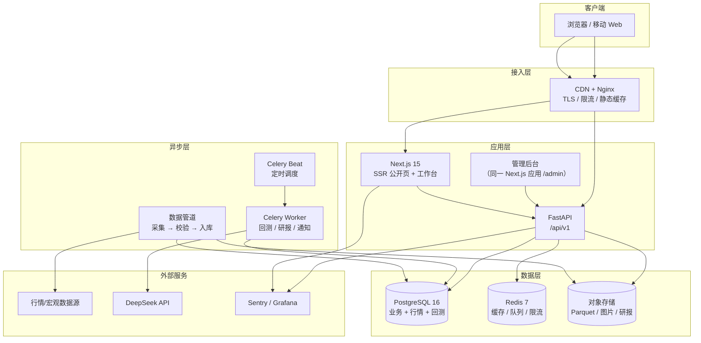

# StockLab · 完整开发计划

| 项目 | 内容 |
|---|---|
| 文档版本 | v2.4 |
| 最近更新 | 2026-10-27 |
| 制定日期 | 2026-10-21 |
| 当前阶段 | V2 个股、支付与会员转化能力持续验收；V2-48 技术验证、V2-49 事件基础本地交付，持仓收息功能待开发 |
| 参考产品 | [稳稳地赢 wenwendeying.com](https://wenwendeying.com/) |
| 代码仓库 | `git@github.com:iamlay/stock.git` |
| 经营主体 | 原记录为暂无，当前状态待核实（见第 17 节） |
| 文档定位 | 项目唯一事实来源（SSOT），每次迭代评审后更新 |

> **阅读指引**：第 0 节是一页纸摘要；研发从第 3、4、5 节开始；排期看第 7 节；测试与上线看第 9、14 节；合规与风险看第 10、13 节；当前商业化渠道与交付看第 17 节；**V2 个股与后续未完成功能看第 18 节；会员转化专项看第 19 节；高股息深度用户专项、任务及排期看第 20 节，详细产品和技术设计见 [高股息收息管理开发方案](DIVIDEND_PORTFOLIO_PLAN.md)**。

> **新增方向（2026-10-27）**：在现有投研能力上补齐“持仓 → 分红权益 → 应收 → 实收核对 → 现金流预测 → 分红风险跟踪”。第 20 节 V2-48 技术验证已在本地交付、业务验收待补证；V2-49 已本地实现并测试、待部署，V2-50–70 待开发，均不代表已上线。首版为 A 股、人民币、单账户 Web；新增权益暂沿用现有单套餐定价。V2-44 关键事件和 V2-46 到期降级为本专项公开灰度的依赖，既有数据质量、备份、退款对账任务继续验收。

> **当前口径（2026-10-26）**：第 0、5、12、17、19 节的会员与支付描述为当前基线；第 7 节保留原始 MVP 排期，不代表当前完成状态。现有价格为 ¥9.99/30 天，第三方网关承接支付宝/微信支付，兑换码保留；邀请码只控制注册，不等于试用权益。试用、有限体验与转化埋点仍按第 19 节实施，不因写入计划而视为上线。

---

## 0. 一页纸摘要

### 0.1 做什么

面向中国个人投资者的 **ETF 投研看板 + 策略回测工具 + 个股股息率模块**，以订阅制变现：

> 2026-10-21 更新：V2 已扩展 A 股个股模块（5,000 只、股息率排序、自选、K 线、质量检查）。本节原始描述以 ETF MVP 为主，个股范围见第 18 节。

1. **今日市场**：市场温度、板块热力、估值分位、宏观数据（社融 / PMI / CPI），每个指标配"怎么读"。
2. **ETF 中心**：红利、现金流、跨境、宽基、行业五大类；列表、详情、同类对比、份额与折溢价。
3. **策略实验室**：规则透明、参数可调的日频策略回测，输出净值曲线、买卖点、交易明细与下一交易日推演。
4. **内容与 AI 研报**：ETF 百科、策略说明、深度文章、AI 辅助研报（人工审核后发布）。
5. **会员与运营后台**：注册登录、邀请/兑换码、会员开通、协议签署、数据管道监控。

### 0.2 不做什么（Non-goals）

- ❌ 不做实盘下单、代客理财、收益承诺、公开荐股。
- ❌ 不做 Level-2 / 高频 / 毫秒级行情。
- ❌ MVP 不做社区评论、跟单、直播。
- ❌ 不提供微信登录、实盘交易与自动扣款续订；现有支付宝/微信支付由第三方网关承接，兑换码保留。
- ❌ 不做原生 App（先 Web，V2 再评估小程序）。

### 0.3 怎么赢

参考产品已经验证了"数据 + 策略 + 内容 + 社群"的付费模式，但仍有四个空位：

| 空位 | 我们的做法 |
|---|---|
| **SEO 弱**（纯 SPA，搜索引擎收录差） | Next.js SSR + 结构化数据 + 每只 ETF 独立落地页，用内容做自然流量 |
| **口径黑箱** | 每个指标附定义、样本区间、数据来源、更新时间；策略附完整成交假设 |
| **回测可信度** | 默认 T+1 开盘成交，杜绝"收盘信号、收盘成交"的未来函数；内置样本外与手工核对用例 |
| **移动端重** | 移动优先布局，首屏 LCP < 2s，弱网可用 |

### 0.4 怎么落地

- **技术**：Next.js 15 + FastAPI + PostgreSQL + Redis；回测引擎用 Python 自研（日频）；单仓 monorepo；Docker Compose 部署阿里云。
- **团队**：2 人等效全职（1 全栈前端 + 1 后端/数据），设计 0.3 人，QA/运维 0.2 人。
- **节奏**：14 周 / 4 个阶段（P0–P3）/ 6 个双周 Sprint；W10 范围冻结。
- **商业化**：基础功能免费，标准会员 ¥9.99/30 天；第三方网关在线支付 + 兑换码双通道，优先补齐试用、购买返回、到账确认和续费闭环（见第 17、19 节）。
- **预算**：一次性约 ¥1,000（域名、认证、数据源），月度约 ¥900–1,200。

### 0.5 里程碑

| 里程碑 | 时间 | 交付 |
|---|---|---|
| M0 立项与基建 | W1（10/19–10/25） | 仓库、CI、数据源验证、交互原型 |
| M1 数据 + 行情 MVP | W2–W4（至 11/15） | 数据管道、今日市场、ETF 列表 |
| M2 ETF + 账户 | W5–W6（至 11/29） | 20 只 ETF 详情、对比、自选、登录 |
| M3 策略实验室 | W7–W9（至 12/20） | 回测引擎、9 个策略、策略看板 |
| M4 商业化 | W10–W11（至 01/03） | 兑换码、会员开通、协议、后台 |
| M5 上线 | W12–W14（至 01/22） | AI 研报 Beta、SEO、压测、灰度发布 |

### 0.6 成功标准（上线 3 个月）

- 注册 → 激活（7 日内完成 1 次自选或回测）≥ 40%；
- 内测首批 50 名用户 7 日留存 ≥ 50%；
- 在线支付与兑换渠道合计真实付费用户 ≥ 30 人（赠送/试用不计入）；转化与续费按第 19.7 节统一口径；
- 数据完整率 ≥ 99.5%，每日 18:30 前完成更新；
- API p95 < 300ms，首页 LCP < 2s，可用性 ≥ 99.5%。

### 0.7 决策演进（更新至 2026-10-26）

| 决策 | 结论 | 对计划的影响 |
|---|---|---|
| 产品范围 | **MVP 只做 ETF**，个股延至 V2 | 数据模型仍预留 `stock` 类型，但不做个股页面、个股筛选与个股策略；20 只重点 ETF 清单冻结 |
| 经营主体 | **暂无个体户 / 公司**（原记录；当前状态待负责人核实） | 技术接入不代表资质、结算、开票条件已确认，运营依赖登记在第 17 节 |
| 变现路径（2026-10-26） | 第三方网关在线支付 + 兑换码 | 已实现创建订单、回调开通；退款、对账、到账确认仍需完善 |
| V2 范围（2026-10-21） | **新增 A 股个股模块**：全市场 5,000 只、股息率排序、自选、K 线、行业、质量检查 | ETF MVP 不变；个股功能与未完成项见第 18 节 |

> 2026-10-19 的“仅兑换码、不做在线支付”是历史决策，已被现有支付实现替代。当前优先级以第 19 节为准；本次不新增年付、专业版或自动续订。

---

## 1. 背景与对标分析

### 1.1 参考产品拆解

> 说明：以下基于其公开页面、前端路由与文案的观察，未接触内部实现；仅用于产品与架构参考，不做像素级复制。

| 维度 | 稳稳地赢的做法 | 启示 |
|---|---|---|
| **定位** | "稳健 ETF 投资看板与社群"，强调控制回撤、红利/现金流 | 切口要窄，"稳健"是心智锚点 |
| **用户** | 有积蓄、厌恶回撤、没时间盯盘的上班族 | 内容必须"可解释"，降低理解门槛 |
| **功能地图** | 今日市场（温度/热力/估值/宏观）；ETF 四类 Hub；20+ 只重点 ETF 详情；策略看板（20+ 规则策略 + 回测明细）；AI 研报；组合实验室；资讯/深度文章；站内信 | 数据、策略、内容三位一体；**详情页是留存核心** |
| **商业化** | 多档订阅 + 微信试用码 + 公众号/社群 + 管理员微信 | 试用码是低成本获客；社群承担续费与答疑 |
| **技术特征** | React SPA + REST API + 独立数据管道 + Grafana Faro 埋点 + 后台"同步看板" | 数据管道与后台可观测性是隐形成本 |
| **体验** | 信息密度高、图表重、术语多 | 我们做"结论先行 + 口径说明 + 移动优先" |

**可改进点**（也是我们的差异化）：

1. SPA 首屏慢、SEO 几乎为零，浪费了 ETF 长尾搜索流量。
2. 回测以"信号当日收盘价"成交，存在未来函数嫌疑，且未充分披露滑点/停牌/涨跌停处理。
3. 指标口径与数据来源披露不足，用户难以判断可信度。
4. 移动端信息密度过高，新用户上手成本大。

### 1.2 目标用户与场景

| Persona | 画像 | 核心诉求 | 关键功能 | 付费意愿 |
|---|---|---|---|---|
| **稳健配置型** 老周 | 38 岁，可投资产 50–200 万，银行理财搬家 | 少亏、有现金流、别天天盯盘 | 红利/现金流 ETF、估值分位、回撤对比、月度策略 | 高（年付） |
| **策略学习型** 小林 | 30 岁，程序员，喜欢回测 | 规则透明、能改参数、能验证 | 策略实验室、交易明细、导出 | 中高（月付转年付） |
| **内容读者** 张姐 | 45 岁，从搜索/公众号进入 | 先看懂，再决定 | ETF 百科、文章、免费工具 | 低转高（试用码） |

### 1.3 产品原则

1. **结论先行**：每个页面首屏给出"今天发生了什么、意味着什么"，再给图表。
2. **口径可查**：任何数字都能点开看到定义、区间、来源、更新时间。
3. **不预测、不荐股**：只做规则推演与历史统计，所有策略标注"非实盘建议"。
4. **移动优先**：390px 宽度下完成 90% 的核心任务。
5. **慢即是快**：宁可少一个功能，不可错一个数字。

---

## 2. 范围与优先级

### 2.1 版本规划

| 模块 | MVP（W1–W6） | V1（W7–W11） | V2（上线后 3 个月） |
|---|---|---|---|
| 今日市场 | 温度、涨跌分布、成交额、板块热力、估值概览 | 宏观卡片（社融/PMI/CPI）、股债利差 | 北向/资金流（若数据可得）、自定义看板 |
| ETF 中心 | 5 大类、20 只重点 ETF 列表 + 详情 | 全市场筛选、同类对比、份额/折溢价 | 提醒、持仓穿透、组合实验室 |
| 策略实验室 | — | 9 个策略、回测、明细、推演 | 20+ 策略、参数寻优、自定义组合 |
| 账户 | 手机号登录、邀请码/兑换码、人工开通 | 手机号 + 邀请体系 | 邀请返利、发票、团队版 |
| 内容 | 静态 About/条款 | 文章 CMS、AI 研报 Beta | AI 研报正式、音频/视频 |
| 后台 | — | 用户/订单/内容/数据任务 | 运营看板、A/B 实验 |
| 社区 | — | 站内信 | 评论、问答（合规评估后） |

### 2.2 范围调节阀

若进度落后（W8 评审触发），按顺序砍：

1. AI 研报 Beta → 延至 V2；
2. 组合实验室 → 延至 V2；
3. 策略数量 9 → 6（保留买入持有、定投、双均线、RSI、布林、网格）；
4. 跨境/行业 Hub → 只保留红利 + 宽基。

**不可砍**：数据正确性、兑换开通闭环、合规声明、监控告警。

### 2.3 合规红线

- 不展示"稳赚""必涨""收益承诺"类文案；不提供买卖点推荐。
- 所有回测页固定展示："历史回测，非实盘承诺，不构成投资建议。"
- 不代客操作账户，不接触用户资金（站内不收款，交易由第三方平台承接）。
- 行情数据仅用于展示与分析，不提供批量下载/转售。

---

## 3. 技术架构

### 3.1 总体架构



### 3.2 技术选型

| 层 | 选型 | 理由 | 备选（何时切换） |
|---|---|---|---|
| Web 框架 | **Next.js 15 App Router** | 公开页 SSR/ISR 解决 SEO；RSC 降低首屏 JS | Remix（团队更熟时） |
| UI | React 19 + TypeScript + Tailwind 4 + shadcn/ui | 开发快、可定制、无锁定 | Ant Design（后台偏重时） |
| 图表 | ECharts 5（按需引入） | K 线、热力、缩放能力成熟 | TradingView Lightweight（仅 K 线） |
| 数据请求 | TanStack Query 5 + RSC | 缓存/重试/乐观更新 | SWR |
| 状态 | Zustand（仅 UI 态） | 轻量，服务端状态交给 Query | — |
| API | **FastAPI + Pydantic v2** | 量化生态在 Python；OpenAPI 自动生成 | NestJS（团队全 TS 时） |
| ORM | SQLAlchemy 2 + Alembic | 成熟、迁移可控 | — |
| 数据库 | **PostgreSQL 16** | 关系 + JSONB + 窗口函数 + pgvector 一库搞定 | ClickHouse（Tick 级数据时） |
| 缓存/队列 | Redis 7 + Celery 5 | 回测/研报异步化 | Arq / Dramatiq |
| 计算 | Polars + NumPy + Pandas | 向量化指标计算快 | — |
| 回测 | **自研日频引擎** | T+1、停牌、涨跌停、分红再投等 A 股规则需完全可控 | vectorbt（研究用，不上生产） |
| AI | DeepSeek API + pgvector | 成本低、中文好；RAG 保证引用可追溯 | 通义/豆包（多供应商降级） |
| 部署 | Docker Compose + 阿里云 ECS | 2 人团队运维成本最低 | K8s（多实例后） |
| CI/CD | GitHub Actions + GHCR | 与仓库天然集成 | — |
| 监控 | Sentry + Prometheus/Grafana + UptimeRobot | 错误、指标、可用性三层 | 阿里云 ARMS |

### 3.3 仓储结构

```text
stock/
├─ apps/
│  ├─ web/                     # Next.js
│  │  ├─ app/
│  │  │  ├─ (marketing)/       # 首页、定价、关于（SSR）
│  │  │  ├─ (app)/             # 工作台、ETF、策略（登录态）
│  │  │  ├─ admin/             # 管理后台
│  │  │  └─ api/               # BFF：仅登录态转发与 Cookie 处理
│  │  ├─ components/
│  │  ├─ lib/
│  │  └─ e2e/                  # Playwright
│  └─ api/
│     ├─ app/
│     │  ├─ api/v1/            # 路由
│     │  ├─ core/              # 配置、安全、日志
│     │  ├─ models/            # SQLAlchemy
│     │  ├─ schemas/           # Pydantic
│     │  ├─ services/          # 业务逻辑
│     │  └─ tasks/             # Celery
│     ├─ alembic/
│     └─ tests/
├─ packages/
│  ├─ quant/                   # 回测引擎（可独立安装）
│  │  └─ stock_quant/
│  │     ├─ data.py
│  │     ├─ indicators.py
│  │     ├─ engine.py
│  │     ├─ metrics.py
│  │     └─ strategies/
│  ├─ contracts/               # OpenAPI → TS 类型与客户端
│  └─ ui/                      # 共享组件（图表、卡片、空态）
├─ etl/
│  ├─ sources/                 # tushare / akshare / 交易所
│  ├─ jobs/                    # daily_bars / shares / valuation / macro
│  ├─ quality/                 # 校验规则
│  └─ dags/                    # 调度定义
├─ infra/
│  ├─ docker/                  # Dockerfile、compose
│  ├─ nginx/
│  └─ scripts/                 # 部署、备份、补数
├─ docs/
│  ├─ DEVELOPMENT_PLAN.md      # 本文件
│  ├─ adr/                     # 架构决策记录
│  ├─ api/                     # 接口说明（OpenAPI 导出）
│  └─ runbook/                 # 故障处理手册
└─ .github/
   ├─ workflows/               # ci.yml、deploy.yml
   └─ ISSUE_TEMPLATE/
```

### 3.4 关键架构决策（ADR 摘要）

| 编号 | 决策 | 理由 | 代价 |
|---|---|---|---|
| ADR-001 | 公开页用 SSR/ISR，工作台用 CSR | 解决 SEO 与首屏；工作台交互重，SSR 收益低 | 两套渲染心智，需明确边界 |
| ADR-002 | 后端用 Python/FastAPI | 数据管道、回测、指标计算同一语言，避免双份逻辑 | 与前端类型需靠 OpenAPI 打通 |
| ADR-003 | 回测引擎自研 | A 股 T+1/涨跌停/停牌/分红规则必须精确；第三方库难改 | 前期投入约 12 人日，需严格测试 |
| ADR-004 | 单库 PostgreSQL 起步 | 数据量（日频，十年约百万行）远未到分库必要 | 后期 Tick 数据需引入 ClickHouse |
| ADR-005 | 模块化单体，不上微服务 | 2 人团队，运维复杂度是最大敌人 | 需靠目录与依赖规则约束边界 |
| ADR-006（历史） | 原计划仅兑换码；现已实现第三方网关在线支付 | 当前边界见第 17 节与 `docs/PAYMENTS.md` | 对账、退款、资质核实和决策记录同步仍需完成 |
| ADR-007 | 数据"授权优先、公开源兜底" | 降低版权与断供风险 | 成本上升，需做多源适配层 |

### 3.5 环境与部署拓扑

| 环境 | 用途 | 配置 | 数据 |
|---|---|---|---|
| local | 开发 | Docker Compose（PG/Redis） | 近 2 年样本 |
| staging | 预发/验收 | 同生产单机，独立 compose project | 全量只读副本 |
| prod | 生产 | ECS 4C8G + RDS PG 2C4G + Redis 1G | 全量 |

发布流程：`main` 合并 → CI 构建镜像 → 推送 GHCR → SSH 到服务器 `docker compose pull && up -d` → 健康检查 `/healthz` → 失败自动回滚上一 tag。

---

## 4. 数据体系

### 4.1 数据源清单

| 数据 | 主源 | 备源 | 频率 | 授权/成本 | 风险 |
|---|---|---|---|---|---|
| ETF/股票日线（OHLCV） | Tushare Pro | 交易所官网、AkShare | 日频 17:00 | 积分制，约 ¥500/年 | 积分规则变动 |
| 实时快照 | 腾讯行情 | 新浪、东财 | 5–15 秒 | 公开接口 | 非授权、限频、字段变动 |
| ETF 份额/规模 | 交易所 | 东财 | 日频 18:00 | 公开 | 延迟一日 |
| 基金净值/IOPV | 基金公司/交易所 | 东财 | 日频 | 公开 | 部分场外净值 T+1 |
| 指数估值（PE/PB/分位） | 中证指数官网 | 申万、自算 | 日频 | 公开（需注明来源） | 历史区间口径差异 |
| 股息率 | 中证指数/自算 | — | 日频 | 公开 | 分红实施日口径 |
| 宏观（社融/PMI/CPI/M2） | 国家统计局、央行 | 东财 | 月频 | 公开 | 发布日不一致 |
| 国债收益率 | 中国货币网 | 东财 | 日频 | 公开 | — |
| 基金持仓 | 基金季报 | 交易所 | 季频 | 公开 | 滞后 15–45 天 |
| 公告 | 巨潮资讯 | 交易所 | 日频 | 公开 | 抓取频率限制 |
| 新闻/资讯 | RSS + 合作方 | — | 实时 | 版权风险 | **MVP 不做**，V2 评估 |
| 北向资金 | 交易所披露 | — | 日频 | 公开 | 2024-08 起取消实时净流入，**仅作 V2 备选** |

**原则**：

1. 所有外部数据先落 ODS（原始文件），再解析入库，保证可回溯、可重放。
2. 每个数据源封装 `SourceAdapter` 接口，主备切换只改配置。
3. 页面上标注"数据来源 + 更新时间"，估值类标注"口径"。
4. 不抓取需要登录/付费墙/明确禁止抓取的数据。

### 4.2 数据分层

```text
ODS（原始层）   交易所/数据源原始 JSON、CSV、Parquet → OSS，按 dt 分区
   ↓
DWD（明细层）   清洗、去重、复权因子、交易日历对齐 → PostgreSQL
   ↓
DWS（汇总层）   估值分位、份额变动、板块聚合、策略指标 → PostgreSQL / Parquet
   ↓
ADS（应用层）   API 直接读取的宽表与物化视图 → PostgreSQL
```

### 4.3 核心数据模型

| 表 | 说明 | 主键 | 预估量级 |
|---|---|---|---|
| `instruments` | 标的字典（ETF/指数/股票） | `code` | 1 万 |
| `trading_calendar` | 交易日历 | `trade_date` | 1 万 |
| `market_daily` | 日线行情（按年分区） | `(code, trade_date)` | 500 万 |
| `etf_profile` | ETF 静态信息（费率、跟踪指数、上市日） | `code` | 1,000 |
| `etf_share_daily` | 份额、规模、折溢价 | `(code, trade_date)` | 100 万 |
| `index_valuation` | 指数 PE/PB/股息率/分位 | `(code, trade_date)` | 100 万 |
| `macro_series` | 宏观指标长表 | `(series_id, period)` | 1 万 |
| `strategies` | 策略定义与默认参数 | `id` | 50 |
| `backtest_runs` | 回测任务与绩效 | `id` | 10 万 |
| `backtest_equity` | 净值曲线 | `(run_id, trade_date)` | 千万级（按需清理） |
| `backtest_trades` | 成交明细 | `(run_id, seq)` | 千万级 |
| `users` / `subscriptions` / `orders` | 账户与商业化 | `id` | 十万 |
| `articles` / `ai_reports` | 内容 | `id` | 千 |
| `data_jobs` / `data_quality_checks` | 管道可观测 | `id` | 十万 |

> 完整 DDL 草案见 [附录 B](#附录-b核心表-ddl-草案)。

### 4.4 调度与数据质量

| 时间 | 任务 | 失败处理 |
|---|---|---|
| 15:05 | 收盘快照、涨跌分布 | 重试 3 次（间隔 1/5/15 分钟） |
| 15:30 | 当日日线（主源） | 切备源，仍失败则告警 |
| 17:30 | 指数估值、股息率 | 重试 + 沿用上一日并标记 |
| 18:00 | ETF 份额、规模、折溢价 | 重试；缺失则页面显示"待更新" |
| 18:30 | 指标计算（分位、聚合）、缓存预热 | 告警；不阻塞已发布数据 |
| 19:00 | 数据质量校验、日报 | 生成质量报告，异常发企微/邮件 |
| 每月 15 日 | 宏观数据（社融/PMI/CPI） | 按发布日历触发 |

**质量规则**（任一失败即告警，严重则阻断发布）：

- 行数波动 > 20%（与近 5 日均值比）；
- 价格 ≤ 0、`high < low`、`close` 超出 `[low, high]`；
- 单日涨跌幅 > ±20%（ETF）触发人工复核；
- 主键重复、交易日不在日历内；
- 份额环比变动 > 50%（防单位错误）；
- 复权因子单调性校验；
- 关键指标连续 3 日为 NULL。

### 4.5 指标口径（必须与页面文案一致）

| 指标 | 定义 | 注意事项 |
|---|---|---|
| 涨跌幅 | `close / prev_close - 1`，使用前复权价 | 分红除权日需复权 |
| 估值分位 | 当前 PE 在近 N 年（默认 5 年）有效样本中的百分位 | 剔除负值；样本 < 250 日不展示 |
| 股息率 | 近 12 个月现金分红 / 总市值 | 注明"近 12 个月" |
| 份额变动 | 当日份额 − 前一交易日份额 | 单位统一为"万份" |
| 折溢价率 | 二级市场价格 / IOPV − 1 | 收盘后用净值近似，标注 |
| 股债利差 | 沪深 300 盈利收益率 − 10 年期国债收益率 | 盈利收益率 = 1/PE |
| 最大回撤 | `min(净值 / 历史峰值 − 1)` | 区间起点为回测起点 |
| 年化收益 | `(期末/期初)^(365/天数) − 1` | 不足 1 年标注"年化参考" |
| 拥挤度 | 份额增速在近 60 日窗口的分位 | 仅用于策略风控说明 |

---

## 5. 功能模块设计

### 5.1 账户、会员与兑换

**目标**：普通用户先完成基础任务，再体验高级工具；有购买意愿时保留当前任务，完成支付或兑换后恢复使用。专项任务见第 19 节。

| 项 | 当前基线与下一步 |
|---|---|
| 登录 | 邮箱 + 密码，验证邮箱后登录；短信登录保留，生产依赖短信服务；不接微信登录 |
| 会话 | 当前 JWT + Web HttpOnly Cookie 转发；登录和验证流程需安全保留 `next` 与原任务上下文 |
| 身份 | 管理角色与权益分离；现有有效会员为 `plan=member` 且未过期；试用状态需统一设计 |
| 邀请 | 邀请码仅用于注册准入与渠道归因，不自动代表会员试用 |
| 试用（待实现） | 用户主动开始一次 7 天高级权益体验；会员与试用统一鉴权；不可重复领取，不覆盖有效付费时长 |
| 会员开通 | ¥9.99/30 天，第三方网关承接支付宝/微信；兑换码、后台人工开通保留并留审计 |
| 协议 | 首页、定价、登录、协议、隐私、个人中心统一支付及权益说明；不把协议签署留痕标为已完成 |
| 续费 | 当前为再次购买/兑换后叠加时长；待增加付费会员到期前 7/3/1 天站内提醒，可选邮件并去重；不自动扣费 |
| 退款 | 网关退款与站内订单、权益调整分别核对；当前未自动闭环，纳入 V2-12 |

**现有接口**：`POST /auth/register`、`POST /auth/login/email`、`POST /auth/verify-email`、`GET /me`、`POST /redeem`、`GET /plans`、`POST /billing/checkout`、`GET /billing/order/{order_no}`、`GET|POST /billing/notify`（均带 `/api/v1` 前缀）。试用启动接口为第 19 节待开发项。

**验收**：

- 登录/邮箱验证后回到原购买或研究任务，仅接受站内允许路径；
- 试用开始、过期、付费升级、续费统一权益判定，前后端结果一致；
- 未登录高级接口返回 401，已登录无权益返回 403，回测额度耗尽返回 429；
- 支付以当前订单服务端状态确认，会员身份不能替代本次订单付款结果；
- 同一兑换码并发核销及同一支付通知重复/并发处理不重复增加权益；
- 试用过期和会员到期保留用户数据，按免费边界使用，不自动删除自选与历史。

### 5.2 今日市场（Dashboard）

| 区块 | 内容 | 数据依赖 |
|---|---|---|
| 市场温度 | 上涨/平盘/下跌家数、成交额、涨停/跌停、5 日均对比 | 日线、涨跌停统计 |
| 板块热力 | 申万一级/二级 Treemap，当日及 5/20 日涨幅 | 行业指数日线 |
| 估值概览 | 沪深 300 / 中证 500 / 红利低波 PE、PB、分位、股债利差 | 指数估值、国债收益率 |
| 宏观卡片 | 社融、PMI、CPI/PPI、外储；配"怎么读"折叠说明 | 宏观长表 |
| 指数走势 | 上证/沪深 300/创业板指 K 线 + 均线 | 日线 |
| 重点 ETF | 按涨跌幅排序的 20 只卡片，可切换净值/份额 | ETF 行情 + 份额 |

**交互**：日期切换（最近 20 个交易日）；图表懒加载；移动端单列卡片。

**验收**：18:30 前数据就绪；抽样 10 个数字与交易所/Tushare 一致；首屏 LCP < 2s。

### 5.3 ETF 中心

**分类**：红利、现金流、跨境、宽基、行业（V2 增加商品、债券）。

| 页面 | 内容 |
|---|---|
| 分类 Hub | 该类核心逻辑、代表 ETF 对比表、相关策略、常见问题 |
| 列表 | 代码/名称/涨跌幅/规模/份额/股息率/估值分位/折溢价；排序、筛选、搜索 |
| 详情 | K 线 + 净值、IOPV/折溢价、份额与规模趋势、跟踪指数估值、前十大持仓、费率、分红历史、同类对比、相关策略 |
| 对比 | 最多 5 只，归一化净值、回撤、波动率、相关性 |

**SEO**：每只 ETF 独立 URL `/etf/{code}`，SSR 输出标题/描述/JSON-LD（FinancialProduct），自动生成 sitemap；内容包含"是什么/怎么买/费率/风险"。

**验收**：20 只重点 ETF 字段完整率 100%；详情页 LCP < 2s；Google/百度收录正常（上线 2 周后检查）。

### 5.4 策略实验室

**目标**：让用户"看懂规则 → 改参数 → 看结果 → 知道下一步"。

**页面**：

1. **策略列表**：按总收益/最大回撤/夏普排序；筛选（类型、标的、仓位方式）；展示净值缩略图。
2. **策略详情**：
   - 顶部结论卡：总收益、年化、最大回撤、夏普、卡玛、交易次数；
   - 净值曲线 vs 基准（买入持有）+ 回撤水下图；
   - K 线叠加买卖点（可开关）；
   - 交易明细表（日期、方向、价格、金额、份额、持有天数、收益）；
   - 参数面板（改动后"重新回测"）；
   - 规则说明（白话 + 成交假设 + 风险提示）；
   - **下一交易日推演**：按最新收盘数据判断是否会触发信号，注明"非下单指令"。
3. **回测任务**：异步执行，前端轮询/SSE 展示进度；结果缓存 24 小时。

**引擎规格**：

| 项 | 规则 |
|---|---|
| 频率 | 日频，收盘后计算信号 |
| 成交时点 | **T+1 开盘价**（默认）；可切换 T 日收盘（对照模式，显著标注偏差） |
| 成本 | 佣金 0.02%（最低 5 元）、滑点 2bp；ETF 无印花税 |
| 约束 | T+1、100 份整数倍、停牌不可成交、开盘涨跌停不成交 |
| 复权 | 后复权计算收益；分红再投 |
| 基准 | 标的买入持有；可选沪深 300 |
| 样本外 | 默认留出最近 1 年，结果页分"样本内/样本外"展示 |

**9 个 MVP 策略**（详见[附录 C](#附录-c策略清单)）：买入持有、每月定投、偏离度分层定投、双均线、MACD、RSI 分位、布林带、等距网格、偏离度调仓。

**正确性验证**：

1. 手工用例 3 个（单笔买卖、定投 12 期、网格穿越 5 次），逐笔核对金额与份额；
2. 买入持有 510300（2020-01-02 至 2024-12-31）与累计净值涨幅误差 < 0.5%；
3. 随机 50 组参数跑通，无负资产、无未来数据（信号日 < 成交日断言）；
4. 性能：单策略 10 年回测 < 2s；批量 100 组 < 60s（异步）。

**验收**：任一策略页可完成"看结论 → 改参数 → 重跑 → 看明细"闭环；所有成交可追溯到日线数据。

### 5.5 自选与组合

| 功能 | 版本 | 说明 |
|---|---|---|
| 自选分组 | MVP | 默认分组 + 自定义；拖拽排序；批量导入代码 |
| 涨跌提醒 | V1.1 | 站内信/邮件，阈值或百分比 |
| 模拟组合 | V2 | 建仓、调仓、收益归因、再平衡建议（不接实盘） |

### 5.6 内容与 AI 研报

- **文章**：Markdown 存储，支持付费墙（`is_premium`）、标签、相关 ETF 关联、目录、代码高亮。
- **AI 研报（V1 Beta）**：输入 ETF → 聚合行情/估值/份额/公告 → 结构化 Prompt → 生成"近期表现 / 资金与份额 / 估值位置 / 风险点 / 数据附录" → 敏感词与事实校验 → 人工审核 → 发布。
- **成本控制**：单篇 token 上限 8k；每用户每日 3 篇；结果缓存 24h；失败降级为模板报告。
- **合规**：AI 内容显著标注"AI 辅助生成，已人工审核"；不出现买卖建议。

### 5.7 消息与通知

| 渠道 | 场景 | 版本 |
|---|---|---|
| 站内信 | 到期提醒、兑换成功、系统公告 | MVP |
| 邮件 | 周报、到期提醒 | V1.1 |

### 5.8 管理后台

| 模块 | 功能 |
|---|---|
| 用户 | 搜索、详情、角色调整、封禁、邀请码/兑换码生成与导出 |
| 订单/订阅 | 查询、兑换记录、补单/延期、退款标记、对账导出 |
| 内容 | 文章 CRUD、AI 研报审核、置顶 |
| 数据管道 | 每次任务状态/耗时/行数/校验结果；手动触发与补数 |
| 运营 | 访问统计（PV/UV/转化漏斗）、渠道码效果 |
| 配置 | 公告、客服邮箱、试用开关、功能灰度 |

### 5.9 埋点与增长

- **现状**：已接入 Vercel Analytics + 百度统计；页面访问统计不等于业务转化漏斗已完成。
- **待实现**：会员墙曝光、试用启动/有效体验、升级点击、创建订单、订单交付、续费等事件；字段、分母、归因与去重见第 19.7 节。
- **漏斗**：基础任务完成 → 高级价值曝光 → 有效体验 → 升级点击 → 创建订单 → 服务端交付 → 次周期续费；支持无需试用直接购买的分支。
- **原则**：不发送邮箱、手机号、兑换码、JWT、完整支付回调或研究参数；采用不含直接身份信息的分析标识，明确告知与保留期限（默认 180 天），限制访问。

---

## 6. 接口设计规范

- **风格**：REST，前缀 `/api/v1`，JSON；OpenAPI 3.1 自动生成并导出到 `docs/api/openapi.json`。
- **认证**：`Authorization: Bearer <access>`；刷新走 httpOnly Cookie。
- **分页**：`?limit=20&cursor=xxx`，返回 `{ "items": [], "next_cursor": null }`。
- **错误**：RFC 9457 Problem Details。

```json
{
  "type": "https://stocklab.dev/errors/plan-required",
  "title": "需要会员权限",
  "status": 403,
  "detail": "该高级功能需要有效会员或试用权益。",
  "trace_id": "01J8Z3K9V6"
}
```

- **回测额度基线**：默认游客 20 次/日、免费账号 50 次/日、有效会员不限次数（部署配置需核实）；试用采用相同免费计算额度、开放高级权益，文案不得继续写 5 次/日。其他技术限流按接口实际配置验收。
- **幂等**：兑换核销与后台开通接口要求 `Idempotency-Key`。
- **缓存**：行情 5s、列表 60s、详情 300s；`ETag` + `Cache-Control`。
- **版本**：破坏性变更升 `/v2`，旧版保留 6 个月。

**接口清单（节选）**：以下混合现有与原始规划接口；会员/支付以第 5.1、19 节及当前 OpenAPI 为准，其余规划接口不代表已实现。

| 方法 | 路径 | 说明 | 权限 |
|---|---|---|---|
| POST | `/auth/sms-code` | 发送验证码 | 匿名 |
| POST | `/auth/login` | 手机号登录 | 匿名 |
| POST | `/auth/refresh` | 刷新令牌 | Cookie |
| GET | `/me` | 当前用户与权益 | 登录 |
| GET | `/plans` | 套餐、价格、权益与可购买状态 | 公开 |
| POST | `/billing/checkout` | 创建第三方网关支付订单 | 登录 |
| GET | `/billing/order/{order_no}` | 查询本人订单状态 | 登录 |
| POST | `/redeem` | 核销权益兑换码（区别于注册邀请码） | 登录 |
| GET | `/market/overview` | 市场温度与涨跌分布 | 登录/试用 |
| GET | `/market/heatmap` | 板块热力 | 登录/试用 |
| GET | `/market/valuation` | 估值与股债利差 | 登录/试用 |
| GET | `/market/macro` | 宏观序列 | 登录/试用 |
| GET | `/etfs` | ETF 列表（筛选/排序） | 登录/试用 |
| GET | `/etfs/{code}` | ETF 详情 | 登录/试用 |
| GET | `/etfs/{code}/shares` | 份额与规模 | 登录/试用 |
| GET | `/etfs/compare?codes=` | 多只对比 | 会员 |
| GET | `/watchlists` | 自选分组 | 登录 |
| POST | `/watchlists/{id}/items` | 添加自选 | 登录 |
| GET | `/strategies` | 策略列表 | 会员 |
| GET | `/strategies/{slug}` | 策略详情与默认参数 | 会员 |
| POST | `/backtests` | 运行回测 | 游客/免费限额，会员不限次数 |
| GET | `/backtests/{id}` | 回测结果 | 会员 |
| GET | `/backtests/{id}/trades` | 成交明细 | 会员 |
| GET | `/articles` | 文章列表 | 公开 |
| GET | `/articles/{slug}` | 文章详情 | 公开/会员 |
| GET | `/messages` | 站内信 | 登录 |
| GET | `/admin/stats` | 运营概览 | 管理员 |
| GET | `/admin/jobs` | 数据任务状态 | 管理员 |

---

## 7. 里程碑与排期

> 本节为初版 MVP 排期历史快照；其中禁止支付、仅兑换码等约束已被第 17、19 节替代。当前会员迭代按第 19.6 节执行。

### 7.1 总览

| 阶段 | 周次 | 日期 | 主题 | 出口标准 |
|---|---|---|---|---|
| **P0** | W1 | 10/19–10/25 | 立项与基建 | 仓库可 CI、数据源连通、原型定稿 |
| **P1** | W2–W6 | 10/26–11/29 | 数据 + 行情 + ETF + 账户 | 内测可看全量行情与 20 只 ETF |
| **P2** | W7–W11 | 11/30–01/03 | 策略 + 会员 + 后台 | 付费闭环跑通，策略可回测 |
| **P3** | W12–W14 | 01/04–01/22 | 内容 + 打磨 + 上线 | 公测上线，监控就绪 |

### 7.2 周计划

| 周 | 日期 | 交付物 | 验收 |
|---|---|---|---|
| W1 | 10/19–10/25 | 仓库初始化、CI、Docker 基线；数据源验证脚本；页面原型（首页/工作台/ETF/策略）；20 只 ETF 清单冻结；**主体路径决策**（个体户 / 第三方平台） | `main` 可构建；10 年日线可入库；原型评审通过；变现方案定稿 |
| W2 | 10/26–11/01 | 数据管道：日线、交易日历、标的字典；质量校验框架；部署 staging | 近 10 年数据完整率 ≥ 99%；每日任务可重跑 |
| W3 | 11/02–11/08 | 估值、份额、宏观数据；指标计算（分位、股债利差）；API 骨架 + 鉴权 | 指标抽样核对通过；`/market/*` 可用 |
| W4 | 11/09–11/15 | 今日市场前端（温度/热力/估值/宏观）；响应式与骨架屏 | 手机端可用；LCP < 2.5s；数字抽样一致 |
| W5 | 11/16–11/22 | ETF 列表 + 分类 Hub + 详情页（K 线/份额/估值/持仓） | 20 只详情完整率 100%；SEO 标签齐全 |
| W6 | 11/23–11/29 | ETF 对比、自选；手机号登录 + 邀请码；内测发布 | 内测用户可完成"登录→自选→看详情"；埋点上报 |
| W7 | 11/30–12/06 | 回测引擎核心：数据加载、撮合、账户、指标；3 个基础策略 | 手工用例通过；买入持有与基准误差 < 0.5% |
| W8 | 12/07–12/13 | 9 个策略全部接入；异步任务与结果存储；回测 API | 100 组参数批量跑通；单次 < 2s |
| W9 | 12/14–12/20 | 策略列表/详情前端；买卖点图、明细表、下周推演 | 闭环可用；移动端可读；错误态完整 |
| W10 | 12/21–12/27 | 兑换码 / 会员开通 / 协议签署；权限中间件；**范围冻结** | 兑换码全流程通过；到期降级正确；无任何支付入口 |
| W11 | 12/28–01/03 | 管理后台（用户/订单/内容/任务）；站内信；兑换码批次 | 运营可自助发码、查单、看任务 |
| W12 | 01/04–01/10 | AI 研报 Beta；文章 CMS；SEO（sitemap/JSON-LD/OG）；周报 | 生成 10 篇人工审核通过；收录检查 |
| W13 | 01/11–01/17 | 性能优化、压测、安全扫描、备份演练、监控告警 | p95 < 300ms；无高危漏洞；恢复演练成功 |
| W14 | 01/18–01/22 | 灰度 10% → 50% → 100%；上线文档、客服话术、复盘 | 无 P0/P1 故障；SLA 达标 |

> 注：元旦（01/01）与周末不计工作日；W10 与 W11 跨年，预留 1 天缓冲。

### 7.3 Epic 拆解与工作量

| Epic | 内容 | 人日 | 依赖 | 阶段 |
|---|---|---|---|---|
| E1 | 工程基建（monorepo、CI、Docker、规范） | 6 | — | P0 |
| E2 | 数据管道（采集、清洗、调度、质量、补数） | 12 | E1 | P1 |
| E3 | 行情看板（API + 前端 + 图表） | 10 | E2 | P1 |
| E4 | ETF 中心（列表、详情、对比、SEO） | 10 | E2 | P1 |
| E5 | 回测引擎（撮合、指标、9 策略、测试） | 16 | E2 | P2 |
| E6 | 策略看板（列表、详情、图表、推演） | 8 | E5 | P2 |
| E7 | 账户与商业化（登录、邀请码、兑换、协议） | 10 | E1 | P2 |
| E8 | 内容与 AI（CMS、研报、审核） | 6 | E7 | P3 |
| E9 | 管理后台（用户、订单、内容、任务） | 6 | E7 | P2 |
| E10 | 上线保障（压测、安全、监控、文档） | 8 | 全部 | P3 |
| — | **小计** | **92** | | |
| — | 缓冲 20% | 18 | | |
| — | **合计** | **110** | | |

**产能假设**：2 人 × 14 周 × 5 天 = 140 人日；扣除会议、支持、评审 20% → 112 人日。与 110 基本匹配，**没有余量做 V2 功能**。

### 7.4 研发节奏

- 双周 Sprint：周一计划（30 min）→ 每日站会（10 min）→ 周三 Demo（20 min）→ 周五回顾（30 min）。
- 每周五更新本计划"进度"列与风险登记册。
- W10 范围冻结后，只修 Bug 与合规问题，不加功能。

### 7.5 关键路径

```text
数据源验证 → 日线入库 → 指标计算 → 行情看板
                     ↘ ETF 详情 → 对比/自选 → 内测
数据源验证 → 回测引擎 → 策略库 → 策略看板 → 会员墙
账户/兑换 → 权限 → 后台 → 上线
```

**关键路径上的三个高风险点**：数据源稳定性、回测正确性、兑换码对账。前两个用"双源 + 手工核对"兜底，第三个用批次化与周对账控制。

---

## 8. 工程规范

### 8.1 分支与提交

- **主干开发**：`main` 始终可发布；功能分支 `feat/xxx`、修复 `fix/xxx`、文档 `docs/xxx`，生命周期 ≤ 3 天。
- **提交信息**：Conventional Commits，例如 `feat(etf): add premium rate card`、`fix(backtest): handle suspended days`。
- **PR**：必须关联 Issue；单个 PR ≤ 400 行（不含生成代码）；至少 1 人 Review；Squash Merge。
- **保护**：`main` 禁止直推；CI 全绿才可合并。

### 8.2 代码质量

| 范围 | 工具 | 门槛 |
|---|---|---|
| 前端 | ESLint + Prettier + `tsc --noEmit` | 0 error；禁止 `any`（除第三方边界） |
| 后端 | Ruff + mypy（strict 核心模块）+ pytest | 0 error；核心覆盖率 ≥ 70% |
| 提交 | pre-commit（lint、format、secret 扫描） | 本地拦截 |
| 依赖 | Dependabot + `pip-audit` / `pnpm audit` | 无高危 |

### 8.3 Definition of Done

一个任务只有满足以下全部条件才算完成：

- [ ] 代码合并到 `main`，CI 通过；
- [ ] 单元测试覆盖核心逻辑，边界条件有用例；
- [ ] 接口有 OpenAPI 描述，前端类型由生成器产出；
- [ ] 错误态、空态、加载态齐全；
- [ ] 移动端 390px 验证通过；
- [ ] 涉及数据的，口径与页面文案一致；
- [ ] 涉及用户可见文案的，通过合规检查（无收益承诺）；
- [ ] 文档/变更记录已更新。

### 8.4 文档

- `docs/adr/`：每个重大决策一篇，模板 `背景 / 选项 / 决策 / 后果`。
- `docs/api/`：OpenAPI 导出 + 鉴权说明。
- `docs/runbook/`：数据源故障、兑换异常、发布回滚、证书续期。
- 本计划：每 Sprint 更新进度与风险。

---

## 9. 测试与质量

### 9.1 测试金字塔

| 层级 | 范围 | 工具 | 目标 |
|---|---|---|---|
| 单元 | 指标计算、撮合、权限、金额 | pytest / Vitest | 核心 ≥ 70% |
| 集成 | API + PG + Redis | pytest + testcontainers | 关键路径全覆盖 |
| 合约 | OpenAPI 与前端类型 | openapi-diff | 破坏性变更阻断 |
| E2E | 登录→邀请码→回测→兑换 | Playwright | 10 条关键流程 |
| 数据 | 完整性、口径、及时性 | 自建校验 + 每日报告 | 0 严重异常 |
| 性能 | 首页、行情、回测 | k6 / Lighthouse | 见 9.3 |
| 安全 | 依赖、镜像、越权 | Trivy、ZAP 基线 | 无高危 |

### 9.2 回测专项验证

1. **手工用例**：3 个固定场景，逐笔核对现金流与份额，误差 < 0.01 元。
2. **基准对照**：买入持有 vs 指数累计涨幅，误差 < 0.5%。
3. **无未来函数**：断言每笔成交日期 > 信号日期（T+1 模式）。
4. **边界**：停牌、涨跌停、分红除权、退市、样本不足、全仓/空仓切换。
5. **回归**：策略参数或引擎改动后，固定 20 组结果快照对比，差异需说明。

### 9.3 非功能指标

| 指标 | 目标 |
|---|---|
| 首页 LCP（4G） | < 2.0s |
| 工作台 TTI | < 2.5s |
| API p95 | < 300ms |
| 回测（10 年，单策略） | < 2s |
| 数据更新完成 | 每日 18:30 前 |
| 可用性 | ≥ 99.5%（月度） |
| 错误率 | < 0.5% |

---

## 10. 安全、合规与风控

### 10.1 应用安全

- 全站 HTTPS，HSTS；Cookie `Secure` + `HttpOnly` + `SameSite=Lax`。
- 密码不落地（验证码登录）；短信接口图形/行为验证 + 手机号频控。
- SQL 全部走 ORM/参数化；输出转义防 XSS；管理后台独立角色校验（前端隐藏 + 后端强制）。
- 兑换码核销在事务内完成（行锁 + 唯一约束）；后台开通需二次确认并写审计日志。
- 管理操作审计日志（ who / when / what / IP ）。
- 密钥存环境变量/密钥管理，不入库、不入仓；CI 开启 secret 扫描。
- 备份：PG 每日全量 + WAL 归档，保留 30 天；每季度恢复演练。

### 10.2 合规清单

| 事项 | 要求 | 责任 | 截止 |
|---|---|---|---|
| 经营主体 | 当前无。W1 决策：注册个体工商户（约 ¥0–500，1–2 周）或走第三方平台 | 负责人 | W1 |
| ICP 备案 | 个人主体备案不得用于经营性网站；收费功能建议主体就绪后开放，或由第三方平台承接交易 | 负责人 | W1 启动 |
| 公安备案 | 上线后 30 日内 | 负责人 | 上线后 |
| 第三方平台 | 知识星球 / 小鹅通等代收，平台承担商户资质；确认抽成、结算周期与退款规则 | 负责人 | W2 |
| 用户协议/隐私政策 | 明确收集范围、用途、删除方式 | 产品 | W9 |
| 免责声明 | 每页底部 + 回测页固定提示 | 前端 | 全程 |
| 数据版权 | 优先授权源；页面注明来源；不提供批量下载 | 后端 | 全程 |
| 适当性管理 | V2 评估（风险测评、冷静期） | 产品 | V2 |

### 10.3 内容红线

- 禁止："稳赚""保本""必涨""跟着买"等表述。
- 禁止：具体买卖点位推荐、收益承诺、代客理财暗示。
- AI 生成内容必须人工审核，且标注生成方式与数据截止日。
- 用户可见的策略文案统一使用"规则推演/历史回测/非实盘建议"。

---

## 11. 运维与监控

### 11.1 监控指标

| 类别 | 指标 | 告警阈值 |
|---|---|---|
| 可用性 | `/healthz` 探活 | 连续 2 次失败 |
| 性能 | API p95、5xx 率 | p95 > 800ms 持续 5 min；5xx > 1% |
| 数据 | 最新交易日、任务耗时、校验失败数 | 18:30 未完成；失败 ≥ 1 |
| 队列 | Celery 积压、失败任务 | 积压 > 100；失败 > 5 |
| 资源 | CPU、内存、磁盘、连接数 | > 80% 持续 10 min |
| 业务 | 兑换成功率、登录失败率 | 兑换失败 > 5%；登录失败 > 20% |

### 11.2 发布与回滚

1. 合并 `main` → CI 构建镜像（tag = commit SHA）→ 推送 GHCR。
2. staging 自动部署 + 冒烟测试（Playwright 5 条）。
3. 手动触发生产部署：`docker compose pull && up -d`，滚动重启。
4. 健康检查 60 秒；失败自动回滚上一 tag。
5. 数据库迁移：先兼容（加列/加表），再切换代码，最后清理；禁止破坏性变更与代码同发。

### 11.3 故障预案

| 故障 | 处理 |
|---|---|
| 数据源断供 | 切备源；页面显示"数据延迟"；启用缓存；公告 |
| 兑换码异常 | 冻结可疑批次；按批次对账；人工补发并记录 |
| 回测任务堆积 | 扩容 worker；限流；清理 7 天前结果 |
| 数据库连接耗尽 | 重启 API；检查慢查询；加连接池上限 |
| 证书过期 | 自动续期（acme.sh）+ 到期前 30 天提醒 |

### 11.4 成本估算（月度）

| 项 | 规格 | 费用 |
|---|---|---|
| ECS | 4C8G，40G SSD | ¥250 |
| RDS PostgreSQL | 2C4G，100G | ¥300 |
| Redis | 1G 标准版 | ¥80 |
| OSS + CDN | 50G + 流量 | ¥50 |
| 数据源 | Tushare 积分 | ¥40（年费摊） |
| LLM | DeepSeek，按量 | ¥100–300 |
| 监控/邮件 | 免费额度 | ¥0–50 |
| 域名/证书 | — | ¥10 |
| **合计** | | **¥830–1,080/月** |

一次性：个体户注册 ¥0–500（可选）、设计外包 ¥0–3,000（可选）。

---

## 12. 运营与增长（冷启动）

| 阶段 | 动作 | 目标 |
|---|---|---|
| 上线前 | 10 篇 SEO 文章（ETF 是什么/红利低波怎么选/费率对比）、3 个免费工具（估值分位、ETF 对比、定投计算器） | 收录 50 页 |
| 上线首月 | 公众号导流、邀请码（7 天）、社群答疑、每周市场周报 | 注册 500，试用 150 |
| 第 2–3 月 | 工具使用案例、用户访谈、有效体验与续费复盘；返利后置 | 累计付费 50 人作为待验证目标，收入按真实订单与续费核算 |
| 持续 | 每周 2 篇内容、每月 1 次策略更新、季度用户访谈 | 月流失 < 5% |

**当前商业化基线（2026-10-26）**：

- 在线支付由第三方网关承接，兑换码保留；生产通道、结算与开票能力由负责人逐项确认。
- 当前只销售标准会员 ¥9.99/30 天，非自动扣费；不新增首月优惠、年付、专业版或返利。
- 免费账号保留基础数据、股票 + ETF 合计 10 个自选、涨跌/除息提醒、默认 50 次/日回测。
- 7 天试用、公开示例、有限体验与续费提醒是待开发能力，不作为现有权益宣传。
- 增长重点是有效体验与次周期续费；价格、额度、有限预览范围的调整需先建立基线并灰度验证（第 19 节）。
- 原“付费 50、MRR ¥2,000”目标与当前价格不一致：50 个按原价购买的月度付费账户对应约 ¥499.50 毛收款/30 天，尚未扣除退款与手续费；非自动续订不直接视为稳定 MRR。

---

## 13. 风险登记册

| # | 风险 | 概率 | 影响 | 应对 | 负责人 |
|---|---|---|---|---|---|
| R1 | 行情数据源变更/断供 | 高 | 高 | 双源适配层；每日校验；关键数据落 ODS 可重放 | 后端 |
| R2 | 数据版权/抓取合规 | 中 | 高 | 授权优先；注明来源；不提供下载；法务咨询 | 负责人 |
| R3 | 无主体导致无法开票/企业备案 | 高 | 中 | 第三方平台承接交易与开票；个体户按需注册；不影响产品上线 | 负责人 |
| R4 | ICP 备案周期超预期 | 中 | 中 | W1 提交；先用香港节点内测（不对外开放） | 负责人 |
| R5 | 回测结果不可信 | 中 | 高 | 手工用例 + 基准对照 + 无未来函数断言 + 样本外 | 后端 |
| R6 | 进度延期 | 高 | 中 | W10 冻结；范围调节阀；每周燃尽图 | 产品 |
| R7 | 单人依赖（bus factor） | 中 | 高 | 文档化；关键模块双人 Review；runbook | 负责人 |
| R8 | 付费转化低 | 中 | 高 | 先修权益与购买闭环，增加有效体验；建立转化/续费基线后单变量验证（第 19 节） | 产品 |
| R9 | 性能不达标（图表多） | 中 | 中 | 按需加载、服务端聚合、CDN、虚拟列表 | 前端 |
| R10 | 合规处罚（荐股/承诺收益） | 低 | 极高 | 文案审核清单；上线前法务过一遍；AI 内容人工审核 | 产品 |

---

## 14. 上线验收清单

### 14.1 功能

- [ ] 邮箱注册/验证/登录/登出/找回；短信能力按生产配置验收
- [ ] 注册邀请码、权益兑换码、主动试用、到期降级和付费续费分别验收（第 19 节）
- [ ] 无微信登录；支付宝/微信第三方支付、兑换码与协议说明一致；订单交付及本人查询通过
- [ ] 今日市场 6 个区块数据正确
- [ ] 20 只 ETF 详情页完整、对比可用
- [ ] 9 个策略可回测、可改参、可看明细
- [ ] 自选增删改排序
- [ ] 文章发布/付费墙/SEO 标签
- [ ] 后台用户/订单/内容/任务
- [ ] 站内信与到期提醒

### 14.2 非功能

- [ ] Lighthouse 移动端 ≥ 85（首页/详情）
- [ ] API p95 < 300ms（压测 200 并发）
- [ ] 数据 18:30 前更新，连续 7 天无失败
- [ ] 备份可恢复（演练记录）
- [ ] 监控告警可达（电话/企微）
- [ ] 无高危漏洞（Trivy + ZAP）
- [ ] 隐私政策/用户协议/免责声明上线
- [ ] ICP 备案号展示
- [ ] 404/500/空态/弱网均有设计
- [ ] 回滚演练成功

### 14.3 上线后 7 天观察

- 错误率、p95、兑换成功率每小时看板；
- 数据任务每日复盘；
- 用户反馈分类（Bug/体验/内容/付费），24 小时内响应；
- 第 7 天出《上线复盘》，更新本计划 v1.1。

---

## 15. 本周行动清单（Sprint 0）

| 日期 | 任务 | 产出 | 负责 |
|---|---|---|---|
| D1（10/19） | 确认产品范围与命名；**主体路径决策**（个体户 / 第三方平台）；开通第三方知识付费店铺；启动 ICP 资料；申请 Tushare | 决策记录 + 店铺链接 + 备案受理号 | 负责人 |
| D1 | 服务器/域名/SSL；GitHub 仓库保护分支与 Actions | 可访问的 staging 域名 | 后端 |
| D2（10/20） | monorepo 脚手架（web/api/quant）；Docker Compose；CI 跑通 | `main` 绿灯 | 全员 |
| D2 | 设计首页/工作台/ETF 详情/策略详情 4 张高保真图 | Figma 链接 | 设计 |
| D3（10/21） | 数据源验证脚本：拉取 510300 十年日线、估值、份额 | 验证报告 + 样例数据 | 后端 |
| D3 | 冻结首批 20 只 ETF 清单与分类 | `docs/etf-universe.md` | 产品 |
| D4（10/22） | 回测引擎原型：买入持有 + 双均线，跑通 510300 | Notebook + 初步结果 | 后端 |
| D4 | 前端设计系统：颜色、字体、图表主题、移动端栅格 | Storybook 基线 | 前端 |
| D5（10/23） | Sprint 0 评审：范围、排期、风险、预算 | 评审纪要 + 计划 v1.1 | 全员 |

**本周必须拿到的三个答案**：

1. 数据源能否稳定拿到 10 年日线 + 份额 + 估值？（不能则调整范围）
2. 变现能否在无主体下跑通？（第三方平台 + 兑换码；不能则先纯免费内测）
3. 2 人 14 周是否现实？（不现实则按 2.2 砍范围）

---

## 16. 待确认事项（Open Questions）

历史范围与经营主体记录见第 0.7 节；当前为 ETF + 个股、第三方网关支付 + 兑换码，不接微信登录。新增会员转化计划见第 19 节。

| # | 问题 | 影响 | 建议默认 | 决策人 | 截止 |
|---|---|---|---|---|---|
| Q1 | 产品名与域名 | 品牌、备案、SEO | 暂用 StockLab | 负责人 | W1 |
| Q2 | 主体路径：注册个体户，还是长期依赖第三方 | 开票、企业备案、品牌信任 | 第三方先行；个体户按需注册 | 负责人 | W1 |
| Q3 | 定价与试用验证 | 转化、收入 | 保留 ¥9.99/30 天；7 天主动试用按第 19 节实施，其他套餐后置 | 产品 | 转化基线复盘 |
| Q4 | 部署地域（境内/香港） | 备案、访问速度 | 境内 + 备案 | 后端 | W1 |
| Q5 | 数据预算上限 | 数据源选择 | ¥1,000/年 | 负责人 | W2 |
| Q6 | 是否接受 AI 生成内容 | 合规、成本 | 人工审核后发布 | 产品 | W10 |
| Q7 | 第三方平台选型 | 抽成、交付、结算 | 知识星球（社群强）/ 小鹅通（课程强） | 运营 | W1 |

---

## 17. 商业化渠道与权益交付（2026-10-26 更新）

### 17.1 当前实现与历史决策

2026-10-19 原计划采用“第三方知识付费平台 + 兑换码”，禁止站内支付；现有代码已实现第三方网关在线支付、订单和自动开通。原 ADR-0008 保留历史背景，其“仅手机号、禁止支付、所有套餐不可购买”等约束不再作为当前研发依据。实施说明见 [PAYMENTS.md](PAYMENTS.md)，转化专项见第 19 节。

### 17.2 渠道边界

- 标准会员 ¥9.99/30 天；支付宝/微信跳转第三方收银台，站内不收集银行卡信息或支付密码，不自动扣款。
- 保留兑换码与后台人工开通；赠送、试用、实际付费必须能区分来源，不以兑换次数替代付费人数。
- 邀请码用于注册准入；兑换码用于权益交付，两者不混用。
- 商户资质、主体、数据授权、结算、退款与发票能力需核实；已实现支付代码不等于生产运营条件已确认。

### 17.3 支付与权益闭环

`选择套餐 → 注册/验证/登录并返回 → 创建订单 → 第三方支付 → 服务端回调验证与交付 → 查询本人订单 → 返回原任务`。

- 金额与时长来自服务端套餐定义；前端套餐说明需复用同一来源或接受一致性校验。
- 回调验签、商户号、金额、订单状态校验已实现；重复/并发通知不得重复发放，须补并发验收。
- 支付返回页不能以 `is_member=true` 判定本次订单已支付；需区分处理中、成功、未完成和查询失败。
- 默认及自定义返回 URL 均须携带订单标识；创建后保留待支付订单信息以支持恢复查询，不保存签名字段或密钥。
- 当前不强制原页面自动重放有副作用的操作；开通后恢复上下文，让用户确认继续。

### 17.4 兑换、续费与退款

- 兑换继续使用事务、行锁、次数、绑定与有效期校验；补充试用码权益判定与领取次数限制。
- 续费从有效付费到期日累加；试用转付费从支付交付时刻计算购买时长，剩余试用不额外累加；试用不得覆盖有效付费会员。
- 会员过期保留自选、提醒配置与历史；超免费额度时阻止新增，停止生成高级提醒，不删除已有数据。
- V2-12 负责每日订单/网关差异核对、人工异常处理、退款状态与权益调整审计；未完成前不得承诺自动退款。

### 17.5 运营依赖与文档同步

- 产品/运营核实交易主体、收款方展示、支持渠道、售后联系方式和退款说明；技术不编造服务承诺。
- 首页、定价、登录、个人中心、会员墙、用户协议、隐私说明、README、MEMBERSHIP、PAYMENTS 与历史 ADR 状态按 V2-37 同步。
- 本轮不扩大支付渠道，不新增自动续订、年付或专业版。发布顺序与灰度条件见第 19 节。

---

## 18. V2 个股模块与后续完善（2026-10-21）

### 18.1 当前状态

V2 个股模块已上线：

| 能力 | 状态 |
|---|---|
| ETF 池 | 100 只精选（2026-10-21 扩容） |
| Dashboard 行业图 | 申万一级行业，5,000 只个股等权 |
| 全市场 A 股 | 5,000 只（非 ST 4,872） |
| 股息率排序 | TTM 默认，年度为辅 |
| 行业 | 申万一级 31 类，5,000 只全覆盖 |
| 分红 | 近十年批量同步，默认 3650 天 |
| 分红标记 | 特别 / 单次大额 |
| 可持续性 | 连续 / 常规 / 核查 / 单次大额 / 高股息 / 无分红 |
| 自选 | 个股自选、任意 6 位代码自动补数据 |
| K 线 | 按需缓存 600 天 |
| 布林 | 日/周/月位置，覆盖有 K 线标的 |
| 管理后台 | 启停、手动同步 |
| 质量检查 | 价格/股息率/行业/分红/时效 |
| 定时更新 | 每日价格、每周分红 |

已知数据：

```text
非 ST 4,872 只
行业为空 0
价格为空 0
TTM > 15% 1 只
TTM > 30% 0
TTM/年度差异 > 5 的 6 只
```

### 18.2 V2 范围与决策

| 决策 | 结论 |
|---|---|
| 市场 | 只做沪深 A 股，不做港股/美股 |
| 覆盖 | 全市场 5,000 只 |
| 用户添加 | 任意 6 位 A 股代码加入个人自选 |
| 股息率 | TTM 优先，详情展示年度 |
| ST | 默认排除，可切换 |
| 行业 | 申万一级用于筛选，三级路径后续补 |
| 行情 | 日频 EOD，不做个股 5 分钟 |
| 用途 | 只做数据与排序，不荐股、不交易 |

### 18.3 未完成功能清单

#### P0：上线收尾与稳定性

| ID | 功能 | 当前缺口 | 验收标准 | 预估 |
|---|---|---|---|---|
| V2-01 | 最新版本部署 | `85cb387` 的迁移 `797e0ddfc988`、分红标记、可持续性、Webhook 尚未部署 | 生产 API/Web 部署完成，页面显示标签 | 0.5 天 |
| V2-02 | 质量告警闭环 | 只有 `--fail-on-fail` 和可选 Webhook，未配置 `STOCKLAB_ALERT_WEBHOOK` | fail 后 Slack/飞书/邮件收到通知 | 0.5 天 |
| V2-03 | 服务 uptime | **已实现** `Uptime Monitor` 每小时检查 API/Web | API 连续 5 分钟不可用触发告警 | 0.5 天 |
| V2-04 | 数据新鲜度告警 | **已实现** 数据超过 10 天或质量 fail 时任务失败 | 每日 ETL 未完成时告警 | 0.5 天 |
| V2-05 | Railway Cron 告警 | 5 分钟报价失败仍依赖 GitHub/Railway 通知 | Cron 连续失败 3 次告警 | 0.5 天 |
| V2-06 | 前端错误监控 | 没有 Sentry/等价工具 | 前端异常可追踪到页面与版本 | 1 天 |
| V2-07 | 备份验证 | **已完成**：加密备份工作流 + DB Restore Test 恢复通过 | 能从备份恢复测试库 | 1 天 |
| V2-08 | 密钥轮换 | 已实现 `security-check` / `rotate-tokens`；实际密钥待轮换 | 全部轮换并更新 Railway 变量 | 0.5 天 |
| V2-09 | DB 公网代理 | 已写迁移顺序；需先把 ETL 迁到 Railway 内网 | API 走内网，关闭公网代理 | 0.5 天 |
| V2-10 | 会员权限边界 | **已完成**：免费自选 10 个；网格/布林/财务为会员；网格提醒会员 | 明确免费/会员范围并落地 | 1 天 |

#### P1：商业化与数据深度

| ID | 功能 | 当前缺口 | 验收标准 | 预估 |
|---|---|---|---|---|
| V2-11 | 支付 Webhook | 基础回调与自动开通已实现（V2-36）；V2-41 已补齐重复/并发与失败重试本地验收 | 同一订单最多交付一次，续费时长正确，失败可恢复 | 纳入 V2-41 |
| V2-12 | 订单对账 | 无每日对账、退款流程 | 每日差异表 + 退款状态 | 1–2 天 |
| V2-13 | 个股 K 线补全 | 已实现 `stock-bars`，高股息前 2,000 只可批量预拉 | 前 2,000 只有 600 天 K 线 | 1–2 天 |
| V2-14 | 行业三级路径 | 已实现 `stock-industry-detail`，高股息前 500 只补 Eastmoney 三级 | 前 500 只详情显示三级行业 | 1–2 天 |
| V2-15 | 分红历史扩展 | **已完成**：默认 3650 天，详情按财年汇总 | 支持查看 5–10 年分红 | 1 天 |
| V2-16 | 新上市/退市/停牌 | 新股票需手动重跑 universe；退市未标记 | 每日更新状态，退市自动隐藏 | 1–2 天 |
| V2-17 | 分红人工复核 | `is_one_off` 是规则判断 | 后台可标记“确认一次性/正常” | 1–2 天 |
| V2-18 | 自选排序/批量 | **已完成**：ETF/个股排序、个股批量移除 | 排序、批量移除、分组 | 1 天 |
| V2-19 | 股票搜索 | **已完成**：`/stocks/search` + 前端联想 | 代码/名称联想搜索 | 1 天 |
| V2-20 | 移动端表格 | **已完成**：`/stocks` 与 `/watchlist` 使用移动端卡片，桌面保留表格 | 列表/筛选/分页移动端可用 | 2 天 |
| V2-21 | 自选提醒 | **已完成**：站内 + 可选邮件，涨跌/除息，每日 ETL 触发 | 站内信或邮件提醒 | 2–3 天 |

#### P2：增长、合规与工程质量

| ID | 功能 | 当前缺口 | 验收标准 | 预估 |
|---|---|---|---|---|
| V2-22 | 个股 SEO | **已完成**：个股/ETF metadata、行业页、ETF 分类页、JSON-LD、sitemap、robots | 个股/行业/分类可收录 | 1 天 |
| V2-23 | 访问分析 | **页面统计已接入** Vercel Analytics + 百度统计；业务转化漏斗未完成 | 页面访问可查；业务转化由 V2-44 验收 | 纳入 V2-44 |
| V2-24 | 数据授权 | 个股来源许可未确认 | 明确可商用范围或换源 | 法务确认 |
| V2-25 | 隐私/免责声明 | 未覆盖个股自选与股息率 | 更新隐私政策与免责声明 | 0.5 天 |
| V2-26 | E2E 测试 | 没有浏览器端回归 | 登录→自选→详情关键路径 | 1–2 天 |
| V2-27 | Staging 环境 | 只有生产 | 预发库 + 预发 Web | 1–2 天 |
| V2-28 | 依赖安全扫描 | 无 Dependabot/SCA | 每周扫描并处理高危 | 0.5 天 |
| V2-29 | 告警降噪 | 质量告警可能每天重复 | 同一问题连续 3 天才通知 | 1 天 |
| V2-30 | 股息网格 | **已完成**：`/stocks/grid`，目标股息率倒推价格；详情页 Tab 化 | 4%–6% 网格价可查 | 2 天 |
| V2-31 | 股息布林 | **已完成**：`/stocks/bollinger`，日/周/月位置与评级；详情 Tab；扩展到 2,000 只 | 2,000 只可看 | 2 天 |
| V2-32 | 股息财务 | **已完成**：`stock_financials`、`/stocks/financial`、详情财务 Tab；营收同比、ROE、ROA、资产负债率、经营现金流、毛利率、净利率；全市场 5,000 只 | 5,000 只可看 | 3 天 |
| V2-33 | 网格提醒 | **已完成**：首次跌破目标股息率价格时站内提醒 | 网格触发可查 | 1 天 |
| V2-34 | 网格 API 硬门禁 | **已完成**：`/api/v1/stocks/grid` 会员专享，页面 Cookie 转发 | 网格数据不再公开 | 1 天 |
| V2-35 | RLY 已宣告分红 | **已完成**：公告日/报告期/进度入库，最新年报 + 最新中期 / 现价 | 自选显示 RLY | 1 天 |
| V2-36 | 易支付在线支付 | **已完成**：页面跳转支付、MD5 验签、异步回调、自动开通会员 | `/pricing` 支付宝/微信 | 1 天 |

### 18.4 后续里程碑

| 里程碑 | 时间 | 交付 |
|---|---|---|
| M6 上线收尾 | 本周 | V2-01 至 V2-02：部署、标签、质量告警 |
| M7 稳定性 | 1 周 | V2-03 至 V2-10：监控、备份、密钥、权限 |
| M8 商业化 | 按第 19.6 节重新排期 | V2-37 至 V2-46 + V2-12：修复闭环、体验价值、漏斗与续费；V2-11 并入 V2-41 |
| M9 数据深度 | 2–3 周 | V2-13 至 V2-17：K 线、三级行业、分红历史、状态、复核 |
| M10 体验增长 | 2 周 | V2-18 至 V2-23：搜索、自选、移动端、SEO、分析 |
| M11 工程质量 | 持续 | V2-24 至 V2-29：合规、E2E、Staging、安全 |
| M12 股息工具 | 1 周 | V2-30 至 V2-32：网格、布林、财务 Tab |

### 18.5 完成定义（DoD）

每个功能完成需同时满足：

- [ ] 代码合并到 `main`；
- [ ] 数据库迁移已执行；
- [ ] `pytest` / `ruff` / `next build` 通过；
- [ ] 生产部署并验证；
- [ ] 有失败回退或降级方案；
- [ ] 文档更新；
- [ ] 监控/告警覆盖。

### 18.6 风险与依赖

| 风险 | 影响 | 应对 |
|---|---|---|
| 个股数据源限流/变更 | 行业/分红缺失 | 批量接口 + 兜底 + 质量检查 |
| 支付平台规则变化 | 订单无法自动对账 | 保留手工登记兜底 |
| 一次性分红误判 | 可持续性标签不准 | 人工复核 + 只做提示 |
| 全市场扩量后性能 | 列表变慢 | `stock_metrics` 索引 + 分页 |
| 数据授权不清晰 | 商用风险 | 尽早法务确认 |
| 密钥泄露 | 安全事件 | 立即轮换 + 关闭公网 DB |

### 18.7 优先级结论

- 原有数据稳定性、备份和安全任务继续独立验收，不因商业化专项取消。
- 商业化闭环按第 19 节继续验收；新增收息方向按第 20 节执行，先做数据验证和单账户账务正确性，再增加分析与付费能力。公开灰度前补齐 V2-44 关键事件和 V2-46 到期降级。
- V2-11 并入 V2-41，不重复建设支付回调；V2-23 区分页面统计完成与业务漏斗未完成。
- 已实现的搜索、自选、SEO 与提醒不重复排期；生产完成状态按第 18.5 节核对。

---

## 19. 会员转化与持续使用专项（2026-10-26）

### 19.1 目标与范围

**目标**：让普通用户完成“基础功能有用 → 高级能力可理解、可体验 → 购买不中断 → 权益明确到账 → 持续使用并续费”。本节为开发计划，实施状态见第 19.5 节；本地验收不代表已部署。没有线上漏斗数据，不宣称当前转化率或改进幅度。

本轮保留 ¥9.99/30 天单套餐和免费基础功能，不先砍回测额度；不开发自动扣费、年付、专业版、返利、AI 研报收费或实盘交易。ETF 用户与个股股息用户分别观察需求，避免用纯个股权益向所有 ETF 用户推销。

### 19.2 已确认问题与影响

下表为专项立项时的问题快照，修复进展见第 19.5 节。

| 问题 | 代码依据 | 改进方向 |
|---|---|---|
| 试用承诺未兑现 | 注册邀请码只创建 free；后台可发 trial 码，`membership.is_member` 仅认可 member | 试用独立生命周期，与会员统一高级权限判定 |
| 购买登录后丢失去向 | CheckoutButtons 传 next，LoginForm 固定跳 account | 注册、验证、登录安全透传返回路径与任务 |
| 支付与权益文案矛盾 | 首页/登录/协议仍写仅兑换；回测配额存在 5/20/50 次不同描述 | 当前事实统一，未交付功能停止宣传 |
| 导出承诺缺少实现依据 | 定价页承诺回测导出，相关页面/接口未发现实现 | 先移除导出承诺，再独立实现与验收 |
| 高级价值不可体验 | MemberGate 整页遮挡网格/布林/财务 | 公开样例、受限预览、主动试用 |
| 触发付费需求时缺少入口 | 第 11 个自选主要展示错误文字 | 保留任务，展示具体收益、价格和升级入口 |
| 到账判断缺少订单依据 | 支付返回后仅延迟查询会员身份 | 本人订单查询、轮询、超时恢复与客服信息 |
| 无业务转化基线 | 仅接入页面统计，缺少业务事件闭环 | 服务端交付为准的漏斗与续费分组分析 |

### 19.3 权益方案：先修正确性，再验证边界

| 能力 | 当前免费基线 | 本轮确定交付 | 待灰度实验 |
|---|---|---|---|
| 行情与基础详情 | 公开可看 | 保持开放，明确数据时间和口径 | 无 |
| 自选 | 股票 + ETF 合计 10 个 | 合计用量可见，第 11 个提供升级入口；到期不删除已有自选 | 不主动收紧额度 |
| 网格/布林/财务 | 会员墙拦截 | 无需登录可看固定标的示例，明确日期和示例属性 | 免费账号体验 1 个自选标的，再按有效体验与付费数据评估 |
| 提醒 | 涨跌/除息免费，高级提醒会员 | 用具体监控任务说明网格/共振价值，升级后回到设置 | 高级提醒作为试用激活任务 |
| 回测 | 默认游客 20/免费 50 次每日，会员不限 | 先保持配额，会员保留历史 | 免费最近 3 条历史、会员完整历史；单独开关验证 |
| 导出 | 文案承诺，尚未确认交付 | V2-37 先下线承诺；V2-45 完成后再恢复 | 不与免费历史实验同时改价 |

受限预览必须在 API 校验允许标的和范围；禁止只用前端遮罩保护全量数据。匿名固定示例与个人真实预览分开提供，不暴露其他用户数据。

### 19.4 试用生命周期与付费规则

- 主动点击“开始 7 天体验”才开始计时，以服务端时间连续计算 7×24 小时；注册或邮箱验证不静默启动。
- 每账号仅一次，需邮箱验证、服务端频控及并发幂等；邀请码只控制注册，不能替代领取试用。
- 统一接口返回权益状态、来源、到期时间及可执行能力；有效试用可使用高级数据、历史和高级提醒，回测计算额度沿用免费账号默认 50 次/日，不再宣称 5 次/日或不限回测。
- 现有付费会员不得领取或被试用覆盖；历史 trial 兑换码纳入同一领取规则，明确迁移与兼容策略，不允许靠不同码重复领试用。
- 试用转付费结束试用，从支付交付时刻起计算 30 天付费权益；有效付费会员续费从原到期日累加。同一账号并发购买、兑换、试用请求不得丢失时长或降级。
- 过期后回到免费能力，保留数据与配置；停止高级提醒生成，普通提醒继续；展示恢复权益入口。
- 试用期间安排“查看一个关注标的 → 理解一个高级指标 → 设置一个高级提醒”的任务，不以承诺收益促销。

### 19.5 开发任务与验收

> **2026-10-26 执行进展**：V2-40 的购买前登录返回链已在本地实现，涵盖邮箱/短信登录、注册、验证邮件与重发邮件；安全保留站内 `next` 的查询参数和锚点，异常地址回退个人中心。13 项认证 API 测试、返回路径回归测试、6 个模拟 API 的浏览器场景、Web 类型检查与生产构建通过。尚未部署；支付到账后恢复原研究任务仍属于 V2-43，不能据此将整个购买闭环标记完成。

**V2-37 本地交付（2026-10-26）**：

- 在售套餐统一由 `/api/v1/plans` 提供，结算复用同一商品定义；免费配额读取实际配置。Web 不再保留独立的价格/权益数组。
- 首页、定价、登录、个人中心、会员墙和协议展示同一来源；明确 ¥9.99/30 天、不自动扣费、ETF + 股票自选合计 10 个。
- 移除未交付的 7 天试用和回测导出宣传；区分注册邀请码与会员兑换码；同步支付、隐私、退款说明和项目文档。后台手工订单改为按实际成交填写，避免默认价格/产品冲突。
- 套餐错误或旧响应不显示旧价格/支付按钮；订单金额与展示金额不一致时阻止跳转收银台，提示刷新确认。
- 已通过套餐/支付/API 回归、前端套餐契约测试、类型检查和生产构建；浏览器验证各页面同步、故障降级、旧接口兼容、价格变动与移动端布局（模拟接口，无真实付款）。
- 发布顺序为先 API 后 Web；当前未部署。V2-39 的试用入口与引导、V2-41 订单状态确认和 V2-45 导出实现继续独立排期。

**V2-38 本地交付（2026-10-26）**：

- `/me` 与认证响应新增 `entitlements`：有效状态、来源、到期时间、试用资格、能力及每日回测上限。`is_member` 仍仅代表有效付费会员；高级数据、历史、自选与高级提醒统一允许有效试用，试用回测沿用免费额度。
- 新增 `POST /api/v1/membership/trial`：已验证邮箱主动领取 7×24 小时体验；重复请求返回原到期时间，已用完/有效会员返回 403，未登录 401，频控 429。前台领取按钮及任务引导属于 V2-39，当前仍不宣传试用。
- 用户行锁保护试用、兑换、付费续期；订单行锁保证重复回调只交付一次。试用转付费从交付时间算起，续费累加现有有效付费时长，永久会员不会被缩短。
- 迁移 `e6a2c9f08314` 保留现有 trial 到期时间，将当前 trial 用户及可追溯的历史兑换用户标为已领取；未使用 trial 码、新生成 trial 码统一 7 天。旧多次使用码仅保存最后一个 `redeemed_by`，无法恢复更早领取者，部署前需用业务留存记录补齐 `trial_started_at`。
- 过期实时回到免费能力，保留自选、回测及提醒配置；高级提醒停止，基础提醒继续。个人中心与高级页面按服务端能力显示。
- 145 项 API 测试通过，覆盖完整回归、真实 PostgreSQL 并发领取/不同码竞争/重复回调/续费兑换竞争、历史数据迁移、到期提醒、Web 类型检查与生产构建。发布顺序：数据库迁移 → API → Web；尚未部署。

**V2-39 本地交付（2026-10-26）**：

- 个人中心增加主动领取入口；定价页引导查看资格，会员权限提示仅向符合资格者提供体验链接。匿名访问保留 `/account#trial` 登录返回路径，注册与验证不会静默领取。
- 区分可领、未验证、体验中、已用/到期、付费和接口未就绪状态；点击后锁定按钮，只有接口返回当前账号有效 trial 权益才展示成功。401 引导重新登录，403 刷新资格，429/网络错误展示真实失败，不乐观激活。
- 展示北京时间到秒的到期时间及权益；新增认证只读 `GET /api/v1/backtests/quota`，显示配置中的每日额度、已用及剩余次数，不清零既有用量。返回页面/到期自动刷新，到期断网也关闭本地高级能力展示。
- 体验中提供“查看关注标的 → 理解股息率网格 → 设置高级提醒”三步导航；不将点击链接记作任务已完成，不增加交易动作或收益承诺。
- 146 项 API 测试（含真实 PostgreSQL 并发）、10 项前端契约测试、全仓 Python 检查、Web 类型检查及生产构建通过。新增 4 项试用状态/时间测试接入现有 GitHub Actions CI；浏览器覆盖 14 个场景，包括移动端、重复点击、401/403/429/500、断网、异常响应、旧 API、付费/已用、到期和登录返回。新增 API 配额生命周期回归。
- 不新增数据库迁移，依赖 V2-38 的 `e6a2c9f08314`。发布仍为 API → Web：Railway 部署 API 后确认 `/backtests/quota` 可用，再发布 Web；尚未推送或验证线上部署。正式灰度仍遵循 19.6 的业务事件与发布门槛。


**V2-40 补齐交付（2026-10-26）**：

- 在前次邮箱/短信登录、注册和验证链修复基础上，补齐会员墙、股票/ETF 加自选入口、导航及需登录页面的安全返回地址；保留 URL 中的标的、查询参数与锚点。
- 从研究页面进入定价页，再登录/注册/验证后，保留原页面、套餐与支付方式；展示选择提示，仍需用户再次点击支付。会话失效导致结算 401 时同样保留上下文；防止连续点击重复创建订单。
- 支付接口新增可选 `next_path`，后端独立过滤站外地址、编码绕过、控制字符和非产品路由。默认及自定义回跳 URL 合并订单号、支付返回标记和安全 next，并纳入支付签名；自定义地址的其他参数/锚点保留。个人中心提供手动返回原页面入口，不把导航当作付款成功证明。
- 策略页原先打开即消耗回测额度，现改为点击“运行回测”才执行。登录/购买返回地址去掉 `run` 执行标记，保留标的、日期和策略参数；返回不会自动支付、添加自选或重复回测。
- 173 项 API 测试（含真实 PostgreSQL 并发）、12 项前端测试、全仓 Python 检查、Web 类型检查及生产构建通过；增加嵌套购买上下文、恶意地址、执行标记过滤及默认/自定义支付回跳签名测试。浏览器验证研究→购买→登录→手动支付→返回、注册验证、短信、过期会话、恶意 next、受保护页面和策略额度共 7 组场景。
- 不新增数据库迁移。先发布 API 后发布 Web；本轮补齐代码尚未推送/验证线上部署。V2-41 的按订单确认到账/轮询，以及 V2-43 的更完整任务恢复与场景升级仍独立验收；不宣称整个购买闭环已完成。


**V2-41 本地交付（2026-10-26）**：

- 移除“已有会员即支付成功”的判断。个人中心仅查询回跳中的当前订单，响应须订单号匹配、状态为 `delivered` 且付款/交付时间有效，才展示交付成功；URL 标记和账号会员状态都不是付款依据。
- 串行每 2 秒查询，自动确认窗口最多 60 秒，单请求超时 10 秒；超时/网络失败可手动重试，不提示重复付款。401 引导带原上下文重新登录，403/404 不泄露其他账号订单；429、退款、关闭、失败状态分别处理。离开页面或切换订单取消旧查询，避免旧响应覆盖新订单。
- 订单查询限制本人在线订单，返回 `delivered_at`，禁止缓存。确认交付后独立刷新会员资料；资料失败不会推翻订单交付事实，可重试刷新。
- 复用 V2-38 的订单/用户行锁、同事务交付以及 V2-40 的默认/自定义回跳订单号。补齐 POST 回调表单依赖；重复已交付回调仍校验金额；拒绝非在线订单、异常金额、错误签名/商户/交易状态及退款订单。
- 186 项 API 测试、20 项前端测试、全仓 Python 检查、Web 类型检查与生产构建通过；包含真实 PostgreSQL 并发领取/续费/重复回调，以及交付写入失败后完整回滚并重试一次成功。新增 8 项订单解析/轮询测试和 19 个模拟 API 的浏览器场景（含移动端与切换订单）；无真实支付、无线上数据库操作。
- GitHub Actions CI 增加订单前端测试及独立 PostgreSQL 16 服务，使用临时 schema 验证并发，不依赖 Railway 凭据；其他定时 workflows 不变。本次无新增数据库迁移，尚未推送/验证线上部署。退款款项处理与对账仍属于 V2-12。


**V2-42 本地交付（2026-10-26）**：

- 网格、布林、财务列表及个股详情的会员墙新增对应教学样例，明确虚构标的、固定日期、用途与数据范围；保留登录、7 天体验资格及带原研究地址的会员入口。固定样例不计入有效试用体验。
- 真实预览独立接口：验证邮箱的免费账号主动绑定一个自己的有效股票自选，三种功能共用该标的且不可更换；绑定不启动试用、不改变会员权益。删除自选/标的及会员到期不重置绑定；数据不足明确展示空态。
- API 用户行锁确保并发只能绑定一个标的；拒绝非本人自选、额外请求字段、查询参数、日期范围与分页。仅返回三档网格、最新日线 20 期布林和最新一期两项财务指标，全量高级接口权限保持不变；个人响应禁止缓存。
- 固定样例开关默认开启；真实预览总开关默认关闭，支持内部账号名单和稳定百分比分桶。正式灰度需等待 V2-44 事件和 19.6 发布门槛，未主动配置线上环境。
- 新增迁移 `f7b3d1a29465` 保存 `users.advanced_preview_code`。194 项 API 测试（含真实 PostgreSQL 并发）、20 项前端测试、Python 检查、Web 类型检查和生产构建通过；12 个模拟 API 浏览器场景覆盖三类列表/详情、移动端、绑定、数据不足、空自选、关闭开关、重试及会员访问。临时数据库全量迁移/回退/再次升级通过；未操作线上数据库或真实支付。


**V2-43 本地交付（2026-10-26）**：

- 股票/ETF 自选达到 API 上限后显示对应价值说明与升级入口，网络错误、邮箱权限等其他错误不误导升级。自选页展示股票 + ETF 合计用量；满额提示保留分组、排序、低估/共振筛选。会员到期提供续费入口，已有自选保留。
- 提醒设置和回测历史使用场景化说明，价格/周期继续读取统一套餐接口，不增加本地价格兜底。历史入口返回 `/account#history`，会员中心续费返回会员区，避免携带旧订单回跳参数。
- 提醒草稿通过有界 URL 字段保留涨跌阈值、除息/邮件、网格目标及共振选择；非法范围、重复参数被忽略。免费用户可准备高级草稿，但保存普通提醒仅提交免费字段，修复原先总是提交网格目标导致 403 的问题。高级草稿不会自动生效，升级返回后仍须确认保存。
- 仅当当前订单交付确认成功时，在支付面板展示对应任务的继续入口；待支付、失败或异常订单不显示到账后的继续提示。沿用安全站内 next，保留标的/筛选/参数/锚点，策略返回移除 run 标记，不自动添加自选、保存提醒、运行回测或再次支付。普通非支付返回入口仍可用，查询变化时同步更新目标。
- 26 项前端测试（新增 6 项任务上下文测试）、14 项权益 API 回归、Web 类型与生产构建通过；13 个模拟 API 浏览器场景覆盖移动端、满额与非满额错误、组合用量、草稿恢复、订单状态、续费、价格失败、加载重试及提醒草稿→套餐→模拟支付→返回后手动保存的完整流程。CI 增加 `test:task-context`，不改部署及数据定时 workflows。
- 本次无数据库迁移，无新增环境变量；依赖既有 V2-38 权益、V2-40 返回参数和 V2-41 订单确认接口。未触及线上数据库或真实支付，尚未推送/部署；V2-44 的事件与转化效果评估继续独立交付。


| ID | 优先级 | 任务 / 负责人 | 验收标准 | 估算人日 |
|---|---|---|---|---|
| V2-37 | P0 | 收费事实与套餐单一来源 / 产品+全栈（本地完成，待部署） | 首页、定价、登录、协议、个人中心、文档一致；明确 ¥9.99/30 天、不自动扣费；自选为 ETF+股票合计；移除未交付导出；前后端价格/权益不独立漂移 | 1–2 |
| V2-38 | P0 | 统一试用与会员权益 / 后端（本地完成） | 统一高级权限判断及过期逻辑；trial 码兼容；并发领取一次、有效会员不被降级、付费续费时长正确；接口 401/403/429 与前端一致 | 2–3 |
| V2-39 | P0 | 试用启动与任务引导 / 前端+后端（本地完成，待部署） | 验证邮箱后可主动领取，展示到期时间、权益和配额；已领/过期/付费状态正确；接口失败不显示激活成功 | 1–2 |
| V2-40 | P0 | 登录返回与购买上下文 / 前端（本地完成，待部署） | 邮箱/短信登录及注册验证链保持原站内任务；拦截外站、协议相对 URL、编码绕过等恶意 next；购买后能回到原页，副作用操作需用户确认 | 1–2 |
| V2-41 | P0 | 订单确认与幂等交付 / 全栈（本地完成，待部署） | 自定义/默认回跳均带订单号；仅本人可查；按订单状态限时轮询，可手动重试；已有会员未支付新订单不显示成功；重复/并发回调只发放一次；并发续费不丢时长 | 2–3 |
| V2-42 | P1 | 高级价值预览 / 产品+全栈（本地完成，待部署） | 网格/布林/财务各有固定样例、日期、用途说明和体验入口；个人单标的预览由 API 控制；全量权益不可绕过 | 2–3 |
| V2-43 | P1 | 场景升级与任务恢复 / 前端（本地完成，待部署） | 自选上限、提醒设置、回测历史展示具体用途和价格；升级/续费入口清晰；保留标的、筛选与参数，支付后可返回继续 | 1–2 |
| V2-44 | P0基础/P1报表 | 业务事件与漏斗 / 全栈+产品 | 首次灰度前完成关键事件、服务端交付及测试过滤；报表可按渠道、ETF/个股、设备、试用状态分组，分母与去重可核查 | 2–3 |
| V2-45 | P1 | 会员回测导出 / 全栈 | 本人且有效权益可导出，其他账号/到期用户拒绝；CSV 含标的、策略、参数、区间、成本、生成时间、指标及交易明细；处理表格公式注入；完成后恢复宣传 | 1–2 |
| V2-46 | P1 | 到期与续费闭环 / 全栈+运营 | 付费会员到期前 7/3/1 天站内提醒，邮件可关闭，同阶段去重；已续费不发旧提醒；过期保留数据，停止高级提醒，显示恢复入口 | 1–2 |
| V2-47 | P2 | 免费边界与定位实验 / 产品+全栈 | 单标的预览、免费最近 3 条历史分别设开关；ETF/股息用户采用匹配的价值说明；一次仅改一个变量，不缩免费配额 | 1–2 |

估算合计 15–26 人日，不包含 V2-12 对账退款、基础设施治理、外部服务等待与生产运营条件核实；联调与回归另预留 20%。不将此估算直接承诺为固定上线日。

### 19.6 实施顺序与发布门槛

以专项启动日为 D0，相对排期；两人等效团队预计约 2–4 周，按依赖和验收调整：

| 阶段 | 参考窗口 | 交付与依赖 | 发布门槛 |
|---|---|---|---|
| A 正确性修复 | D0 起第 1–2 周 | V2-37/38/40/41，V2-44 关键事件；V2-39 依赖 V2-38 | 套餐一致；购买返回、权限、交付、并发续费、订单确认回归通过；未就绪的试用入口隐藏 |
| B 价值体验灰度 | 第 2–3 周 | V2-39/42/43/45/46，V2-44 报表；V2-12 并行登记独立工作量 | 先内部账号，再约 10% 符合条件账号；匿名只开放固定样例；无越权与错误收费；关键事件可追踪 |
| C 基线与单变量验证 | 第 3–4 周起 | V2-47；在 A/B 稳定且数据完整后开始 | 单一实验稳定分组、至少观察 14 天；样本不足只访谈与描述，不宣称显著提升 |
| D 续费复盘 | 首批真实付费满 30 天后 | V2-44/46，结合 V2-12 退款与成本数据 | 对同一到期 cohort 观察到期后 7 天续费；数据成熟前不调整年付或长期收入预期 |

试用、单标的预览、免费历史和新会员墙分别设开关；问题时关闭新增入口、停止新试用领取，不撤销已发放合法权益。支付交付必须继续处理已有订单；按订单日志补偿并留审计，禁止通过重复回调补发。

### 19.7 指标、事件与实验口径

**事件**：`core_task_completed`、`paywall_view`、`sample_view`、`trial_started`、`trial_value_used`、`upgrade_clicked`、`checkout_created`、`payment_delivered`、`membership_renewed`、`membership_expired`、`payment_refunded`。注册/验证、登录成功作为辅助事件；创建订单、交付、退款和续费由服务端产生，浏览器回跳不计支付成功。

**字段与去重**：分析标识、event_id、服务端时间、feature、entry_point、channel、ETF/个股场景、experiment_id/variant；订单事件使用内部订单关联键，交付按订单去重，续费不得再被计为首次付费。访客到账号的归因仅使用明确告知的第一方标识；测试、管理员、赠送和历史订单与真实销售分开。订单金额、退款与会员来源以服务端记录核对。

| 指标 | 分母与观察窗口 |
|---|---|
| 基础激活率 | 完成注册的用户中，7 天内至少完成 1 次自选或回测的用户占比 |
| 试用启动率 | 看到试用入口且符合领取条件的登录用户中，7 天内开始试用的去重用户占比 |
| 试用有效体验率 | 试用启动用户中，7 天内成功查看个人标的高级结果或成功配置高级提醒的去重用户占比；固定样例不算 |
| 体验到首购率 | 首次有效体验后 7 天内首次真实付费人数 / 已完整观察 7 天的首次有效体验用户；无试用直接首购单列 |
| 会员墙到首购率 | 首次看到会员墙后 7 天内首购用户 / 已完整观察 7 天的会员墙非付费用户 |
| 订单交付率 | 创建后 24 小时内交付的订单数 / 已完整观察 24 小时的真实销售订单数；未付款与支付失败分别看 |
| 到账延迟 | 支付渠道成功时间至权益交付时间的 p50/p95，另看超过 60 秒未交付订单；先建立基线再设 SLO |
| 次周期续费率 | 当期付费即将到期用户中，到期前 7 天至到期后 7 天完成付费延长权益的人数占比；试用、赠送、重复订单不计 |
| 净收入与成本 | 毛收款减退款、支付手续费，结合数据/基础设施/客服成本；与到期留存一起判断 ¥9.99 是否可持续 |

每周复盘同时展示分子、分母、成熟观察窗口和实验版本；首期以建立至少 14 天稳定基线为目标，不预设缺少依据的转化提升百分比。护栏为基础激活、7 日留存、退款、投诉、越权与交付异常；实验开始前根据基线约定停止条件，任何越权或重复收费/交付立即停止相关灰度并排查。

### 19.8 专项完成定义

- [ ] P0 权益、试用、登录返回、订单确认和文案任务全部通过验收，P1 状态独立列出，不混称整体完成。
- [ ] API 集成覆盖试用一次性/到期、会员续费、并发回调/兑换、本人订单与历史权限、导出安全；E2E 覆盖注册验证后购买返回、试用升级、支付延迟、过期恢复。
- [ ] 免费/试用/会员/过期账号在桌面与移动端走查，无错误成功提示、无数据丢失。
- [ ] 灰度前关键事件可核对，分析端交付订单与业务订单一致；续费必须等完整周期后复盘。
- [ ] 套餐、协议、售后、文档与生产配置一致；退款对账仍依赖 V2-12，不标为自动完成。
- [ ] 有开关、监控、订单补偿和回滚说明；通过后再按第 18.5 节执行部署验收。

---

## 20. 高股息深度用户：持仓、收息与分红质量专项（2026-10-27）

### 20.1 目标与边界

将产品扩展为“高股息研究与收息管理工作台”：用户既能研究标的，也能管理自己的真实分红收入，并知道预期收入发生变化的原因。详细数据口径、页面、接口、测试、部署与运营设计见 [高股息收息管理开发方案](DIVIDEND_PORTFOLIO_PLAN.md)。本节是任务编号、依赖及完成状态的唯一来源，详细方案不另维护状态表。

首版锁定 A 股普通现金分红、人民币、单账户、手动和标准 CSV；支持有生效日期的期初持仓。先完成单账户收息闭环，再做高级分析与多账户。ETF、港美股、OCR、复杂公司行动及复利模拟在后续门槛满足后逐项交付。首版不连接证券账户，不承诺自动核实到账，不将预案视为已确定应收。用户录入的账本长期可读、可改、可导出，会员到期不删除或冻结既有账本。

### 20.2 任务清单与验收

全部任务初始状态为 **待开发**；实施后逐项登记“本地完成 / 已测试 / 已部署 / 已验收”及证据，不用单一“完成”替代发布状态。人日包含该任务正常实现和测试，不含数据采购、外部等待及统一发布缓冲。

| ID | 优先级 | 任务 / 主要负责人 | 前置依赖 | 验收标准 | 人日 |
|---|---|---|---|---|---|
| V2-48 | P0 | 需求验证、数据源验证与口径冻结 / 产品+数据（技术部分本地完成，业务验收待补证） | 无 | 访谈 10–15 位目标用户；至少 30 个分红样本覆盖缺日期、更正、取消、多次派息；核实登记日/派息日、可追溯来源和更新时效；形成字段字典、历史覆盖边界、数据使用条件和带预期值的算例；不足则明确阻断或人工模式 | 3–5 |
| V2-49 | P0 | 分红事件版本与日期补齐 / 后端+数据（本地完成并测试，待部署） | 48 | 复用现有分红数据，补事件稳定标识、登记日、派息日、方案阶段、原始来源和修订历史；同报告期多次分红不合并；重复同步不重复建事件；未知日期不填默认值；旧接口兼容 | 4–6 |
| V2-50 | P0 | 私人账户、账本与隐私基础 / 后端+前端 | 48 | 建单账户及私人数据所有权；首次录入前展示新隐私说明并留版本记录；本人 CRUD、免费导出、删除可用；跨用户读取/写入/缓存隔离测试通过；不要求券商账号及证件 | 3–5 |
| V2-51 | P0 | 期初持仓、交易流水与重算 / 后端 | 50 | 期初生效日、买卖、费用、显式持仓调整、冲正可追溯；禁止卖出超额、负数量和未来成交；同日顺序稳定，Decimal 运算；历史修改重算后受影响分红待核对；历史未知不自动补权益 | 5–8 |
| V2-52 | P0 | 登记时点权益与应收计算 / 后端+数据 | 49、51 | 按登记日收盘有效持仓和正式实施方案生成应收；保存持仓/方案版本；登记后卖出仍保留权益；预案只算情景；重复任务幂等；更正后不覆盖已确认实收；送转等未支持情况阻断自动计算 | 5–8 |
| V2-53 | P0 | 实收账本与到账核对 / 全栈 | 52 | 自动应收、用户确认实收和差异分开；支持部分到账、多笔到账、税费调整、撤销确认及人工未关联记录；实际入账日统计；到派息日不自动记实收；所有修改有审计记录 | 4–6 |
| V2-54 | P0 | 手动录入与标准 CSV 导入导出 / 全栈 | 51、53 | 模板、逐行预校验、预览确认、批次回滚/冲正、重复批次与疑似重复行提示；允许确认合法相同交易；持仓与现金流水可免费导出；金额和日期不歧义；限制大小并处理 CSV 公式注入 | 4–6 |
| V2-55 | P0 | 我的收息、持仓与分红日历 / 前端+后端 | 52、53 | 独立收息入口，月历与列表、年度已收/正式待收/预案分层、下笔预计到账、未核对和空态；未知日期单列；PC/移动布局可用；详情跳转保留股票上下文；不改原投研首页默认入口 | 5–8 |
| V2-56 | P0 | 任务调度、质量监控与首版发布 / 后端+运维 | 49–55；44关键事件；46降级；备份恢复可用 | 同步、应收重算、核对待办按依赖运行；补跑、互斥、去重、失败重试和运行记录可查；完成隔离库迁移演练、生产备份/恢复验证及开关回退；内部样本逐笔一致后发布有限白名单 | 3–5 |
| V2-57 | P1 | 未来十二个月现金流与目标 / 全栈 | 56 | 已收、正式待收、预案和历史推算分层且不重复；按持仓不变假设预测，不把未知日期分摊成确定月份；展示基准日、假设和收入目标差额；修订可追踪 | 4–6 |
| V2-58 | P1 | 分红质量数据与行业模板 / 数据+后端 | 48、49 | 普通/特别分红、每股分红序列、同口径减派、利润派息率与现金覆盖来源可追溯；财报年度/中期不混加；补资本开支/必要行业数据；工业与金融模板分开，缺失或分母无效不打正常标签 | 5–8 |
| V2-59 | P1 | 分红质量解释与研究联动 / 全栈 | 58 | 个股和持仓展示连续性、覆盖能力、异常及变化；每条结论有证据、报告期、规则版本和未知状态；普通/特别口径可切换；不输出无依据安全分；基础历史免费，高级解释会员可用 | 3–5 |
| V2-60 | P1 | 股息集中度与减派压力测试 / 全栈 | 57、58 | 股票/行业按股息贡献计算占比，显示覆盖率；最大来源减派 20%/30%及剔除特别分红可重算；与原现金流基线一致；情景冲击不重复相乘；未知行业单列 | 3–5 |
| V2-61 | P1 | 分红变化、风险与核对提醒 / 全栈 | 49、52、58；46 | 基础日历/核对待办免费，高级减派/覆盖恶化监控按权益；事件修订有差异、来源与个人收入影响；去重、静默时段、退订与取消重发；数据延迟不冒充公司变化；到期普通待办继续 | 4–6 |
| V2-62 | P1 | 收息会员权益与场景转化 / 全栈+产品 | 57、59–61；44、46 | 沿用统一套餐及 ¥9.99/30 天；免费单账户基础账本、日历、核对和导出；高级预测/分析/自动风险监控按试用及会员授权；API 校验；到期保留高级结果快照并标日期，停止新高级计算；支付返回任务无自动副作用 | 2–4 |
| V2-63 | P1 | 多账户与家庭汇总 / 全栈 | 56、62 | 免费 1 个、会员暂定最多 10 个账户由套餐配置；账户独立、本人汇总不重复；支持成对转入转出，非买卖、不计收入且保留归属证据；到期保留并可维护已有账本，停止新增超额账户和高级汇总；不引入家庭共享权限 | 4–6 |
| V2-64 | P1 | 收息激活、留存与续费验证 / 产品+全栈 | 44、55、62 | 首次有效持仓、首次应收、首次核对、有效高级体验、真实首购与续费可核查；不记录持仓金额/明细到分析平台；按成熟 cohort 和真实分红机会统计；至少 14 天技术基线及一个真实收息周期后复盘 | 2–3 |
| V2-65 | P2 | 个人估值纪律与研究笔记 / 全栈 | 59 | 记录买入理由、目标普通股息率、复核条件、来源和修改历史；关注条件命中可回看，不自动交易；成本息率与当前价格息率分开；私有数据隔离 | 3–5 |
| V2-66 | P2 | 分红再投资与长期收息模拟 / 量化+全栈 | 57、58 | 支持不再投/定期再投、追加投入、减派和费用假设；历史回测用当时可知数据，现金派息与复权不重复计收益；假设和估算清晰；历史数据不足仅开放情景模拟 | 5–8 |
| V2-67 | P2 | ETF 现金分红与基础公司行动 / 数据+全栈 | 49–56；独立数据验证 | ETF 每份分红、权益日历单独验证；送股/转增/拆并股建独立行动与持仓数量、成本调整；不把复权价格当账本价格；未支持配股等继续人工阻断；完整案例核对后扩量 | 5–8 |
| V2-68 | P2 | 港美股与多币种 / 数据+全栈 | 63、67；目标市场数据评审 | 标的含市场维度；按市场规则计算权益；原币、本位币、汇率日期、实际预扣税分开记录；币种不直接相加；托管费和实际税费可修正；先选一个市场灰度，不同时铺开 | 8–12 |
| V2-69 | P2 | 券商截图 OCR 辅助导入 / 全栈+数据 | 54；隐私与服务商评审 | 先选一个券商模板；识别只生成草稿，逐项确认后入账；低置信度提示、去重、原图删除时限与失败恢复；不索要密码；图片不得进入日志或分析平台 | 5–8 |
| V2-70 | P2 | 移动使用增强与年度收息报告 / 前端+产品 | 64；稳定真实账本 | 根据留存反馈增强 Web/PWA；年度报告与账本一致，分享默认隐藏持仓和金额、用户预览确认；不自动公开；推送需单独授权；达到需求门槛再评估原生 App | 3–5 |

**V2-48 本地技术交付（2026-10-27，整体验收未通过）**：新增只读分红探针及离线回放，保存 4 只股票的 40 条真实接口记录与逐条缺口报告；另核对 1 份发行人实施公告。确认登记日字段存在但现有模型未保存，源响应缺派息日、稳定事件身份与公告关联，预披露金额及日期缺失不能补值。交付字段字典、事件修订规则、20 个产品计算/状态算例和访谈包，详见 [V2-48 验证报告](V2_48_VALIDATION_REPORT.md)。真实访谈为 0/10–15；逐公告更正/取消覆盖、持续更新时效、历史完整性及商业使用条件仍未验证，自动权益和自动到账不放行。可进入 V2-49/50 的基础模型、未知状态和人工核对开发；公开灰度仍须补齐这些证据。47 项探针回归测试、Ruff 检查、格式检查、JSON/文档链接及差异检查通过。本任务不修改生产数据、迁移、调度或收费权益。

**V2-49 本地交付（2026-10-27，待部署）**：新增稳定 UUID 事件、只追加版本和原始来源观察队列；同次抓取兼容既有研究记录并保留未知/零金额/取消等完整来源。重复核心内容去重，动态行情字段不产生伪修订；不按报告期或文字自动关联，管理员明确新建/修订/忽略，版本冲突和旧证据覆盖需要确认，重复核对不重复建事件或审计。新增公开事件/版本查询、管理员证据核对 API、有界默认 dry-run 的旧数据回填；未知派息日为空，补录须有公告依据，所有自动权益/自动到账结果仍为 false。新增迁移 `c8d4e6f29013`，旧表及旧接口不改；临时 PostgreSQL 完整升级、带旧数据回填、重复执行、回退再升级和并发回归通过，API 全套 288 项测试及全仓 Python 检查通过。技术取舍见 [ADR-0009](adr/0009-dividend-event-versions.md)，发布和操作见 [V2-49 交付说明](V2_49_DELIVERY.md)。本次没有操作生产数据库，V2-48 待补证项仍保留为正式收息发布条件。

### 20.3 里程碑、工作量与执行顺序

| 阶段 | 范围 | 工作量 | 出口 |
|---|---|---|---|
| M9 数据与方案冻结 | V2-48 | 3–5 人日 | 数据源和口径通过；无法支持的自动化明确关闭 |
| M10 单账户收息闭环 | V2-49–56 | 33–52 人日 | 真实持仓 → 正式应收 → 人工核对实收 → 年度汇总，内部白名单可用 |
| M11 专业分析与商业验证 | V2-57–64 | 27–43 人日 | 现金流、质量证据、压力测试、提醒、多账户、权益与业务事件可验收 |
| M12 深度扩展 | V2-65–70 | 29–46 人日 | 按需求和数据成熟度逐项评审，非一次性交付承诺 |

合计 **92–146 人日**；P0 首版 **36–57 人日**，P0+P1 **63–100 人日**。发布联调、数据问题和回归额外预留 20%–30%；V2-44/46 剩余工作及基础设施历史欠账另计。按两名等效全职、每天合计约 1.5 个有效人日估算，P0 约 6–10 周，P0+P1 累计约 11–18 周；一人实施按总人日及实际产能重新排期，不承诺固定日历日期。真实派息验证等待不计作开发人日。

推荐先启动 V2-48，继而并行准备 49 与 50，随后按 51 → 52 → 53 推进。54 可在账本契约冻结后与 55 的界面开发交错进行，56 为首版统一出口。P1 的数据分析与现金流可按依赖交错，但会员宣传必须等待对应交付验收；63 只在单账户核对稳定后启用。P2 不抢占 P0/P1 正确性工作。

### 20.4 与现有计划的关系

- V2-44 继续作为统一业务事件基础；本专项只扩展收息事件，不再建第二套漏斗。
- V2-46 继续承担统一到期状态与续费提醒；本专项扩展到期后的计算、提醒和多账户行为。
- V2-45 会员回测导出与私人账本免费导出是不同产品能力，分别验收；V2-47 的免费边界实验延后至收息基线稳定，避免同期开多个变量。
- 现有自选合计额度不等于真实持仓额度：首版持仓标的数量不挂钩 10 个自选上限，使用服务端防滥用限制而非隐含付费墙。
- 本专项不重做五分钟报价、现有股票详情、支付或通知基础设施；展示行情必须明确时间，记账和历史权益不使用实时价格替代成交或登记数量。
- 本节优先级覆盖本专项；第 7 节原始 MVP 排期及附录 B 的早期 DDL 不作为新增账户/账本实现规范。每项必须完成代码、测试、迁移、上线和文档证据后再按第 18.5 节验收。

---

## 附录 A：页面地图

| 路由 | 页面 | 权限 | 渲染 |
|---|---|---|---|
| `/` | 首页（价值主张、功能、定价、FAQ） | 公开 | SSR |
| `/pricing` | 定价 | 公开 | SSR |
| `/login` | 登录/注册 | 公开 | CSR |
| `/legal/terms`、`/legal/privacy` | 条款/隐私 | 公开 | SSR |
| `/dashboard` | 今日市场 | 登录/试用 | CSR |
| `/etf` | ETF 总览 | 登录/试用 | SSR + CSR |
| `/etf/dividend`、`/cash-flow`、`/overseas`、`/broad`、`/industry` | 分类 Hub | 登录/试用 | SSR |
| `/etf/[code]` | ETF 详情 | 登录/试用 | SSR |
| `/etf/compare?codes=` | 对比 | 公开 | CSR |
| `/strategies` | 策略列表 | 公开 | SSR |
| `/strategies/[slug]` | 策略详情/回测 | 游客/免费限额，会员不限次数 | SSR |
| `/watchlist` | 自选（ETF + 个股） | 登录 | CSR |
| `/stocks` | 高股息个股列表 | 公开 | SSR |
| `/stocks/[code]` | 个股详情/分红/K 线 | 公开 | SSR |
| `/admin/stocks` | 个股管理 | 管理员 | CSR |
| `/articles`、`/articles/[slug]` | 文章 | 公开/会员 | SSR |
| `/messages` | 站内信 | 登录 | CSR |
| `/account` | 个人中心/订阅 | 登录 | CSR |
| `/renew` | 续费 | 登录 | CSR |
| `/admin/*` | 后台（用户/订单/内容/任务/统计） | 管理员 | CSR |
| `/403`、`/404`、`/500` | 错误页 | 公开 | SSR |

## 附录 B：核心表 DDL 草案

```sql
-- 标的字典
CREATE TABLE instruments (
  code         varchar(16) PRIMARY KEY,
  name         varchar(64) NOT NULL,
  type         varchar(16) NOT NULL,          -- etf | index | stock
  exchange     varchar(8)  NOT NULL,          -- SH | SZ | HK
  lot_size     integer     NOT NULL DEFAULT 100,
  listed_on    date,
  delisted_on  date,
  is_active    boolean     NOT NULL DEFAULT true,
  created_at   timestamptz NOT NULL DEFAULT now()
);

-- 日线（按年分区）
CREATE TABLE market_daily (
  code        varchar(16) NOT NULL REFERENCES instruments(code),
  trade_date  date        NOT NULL,
  open        numeric(12,4) NOT NULL,
  high        numeric(12,4) NOT NULL,
  low         numeric(12,4) NOT NULL,
  close       numeric(12,4) NOT NULL,
  prev_close  numeric(12,4),
  volume      bigint,
  amount      numeric(18,2),
  adj_factor  numeric(12,6) NOT NULL DEFAULT 1,
  PRIMARY KEY (code, trade_date)
) PARTITION BY RANGE (trade_date);

-- ETF 静态信息
CREATE TABLE etf_profile (
  code            varchar(16) PRIMARY KEY REFERENCES instruments(code),
  tracked_index   varchar(16),
  category        varchar(16) NOT NULL,       -- dividend | cashflow | overseas | broad | industry
  manager         varchar(64),
  fee_rate        numeric(6,4),
  inception_date  date,
  metadata        jsonb NOT NULL DEFAULT '{}'
);

-- ETF 份额与折溢价
CREATE TABLE etf_share_daily (
  code        varchar(16) NOT NULL,
  trade_date  date        NOT NULL,
  shares      numeric(18,2),                  -- 万份
  aum         numeric(18,2),                  -- 亿元
  nav         numeric(12,4),
  iopv        numeric(12,4),
  premium     numeric(8,4),
  PRIMARY KEY (code, trade_date)
);

-- 指数估值
CREATE TABLE index_valuation (
  code        varchar(16) NOT NULL,
  trade_date  date        NOT NULL,
  pe_ttm      numeric(10,4),
  pb          numeric(10,4),
  dividend_yield numeric(8,4),
  pe_pct_5y   numeric(6,4),
  pb_pct_5y   numeric(6,4),
  PRIMARY KEY (code, trade_date)
);

-- 宏观长表
CREATE TABLE macro_series (
  series_id   varchar(32) NOT NULL,           -- shrz | pmi | cpi | m2 ...
  period      date        NOT NULL,
  value       numeric(18,4) NOT NULL,
  unit        varchar(16),
  source      varchar(32),
  released_at timestamptz,
  PRIMARY KEY (series_id, period)
);

-- 用户与订阅
CREATE TABLE users (
  id            uuid PRIMARY KEY DEFAULT gen_random_uuid(),
  phone         varchar(20) UNIQUE,
  nickname      varchar(64),
  role          varchar(16) NOT NULL DEFAULT 'user',  -- user | admin
  status        varchar(16) NOT NULL DEFAULT 'active',
  created_at    timestamptz NOT NULL DEFAULT now(),
  last_login_at timestamptz
);

CREATE TABLE subscriptions (
  id          uuid PRIMARY KEY DEFAULT gen_random_uuid(),
  user_id     uuid NOT NULL REFERENCES users(id),
  plan        varchar(16) NOT NULL,           -- trial | standard | pro
  status      varchar(16) NOT NULL,           -- active | expired | canceled
  started_at  timestamptz NOT NULL,
  expires_at  timestamptz NOT NULL,
  source      varchar(32)                     -- invite | redeem | admin
);

-- 回测
CREATE TABLE backtest_runs (
  id           uuid PRIMARY KEY DEFAULT gen_random_uuid(),
  user_id      uuid REFERENCES users(id),
  strategy     varchar(32) NOT NULL,
  symbol       varchar(16) NOT NULL,
  params       jsonb NOT NULL,
  start_date   date NOT NULL,
  end_date     date NOT NULL,
  status       varchar(16) NOT NULL,          -- queued | running | done | failed
  metrics      jsonb,
  error        text,
  created_at   timestamptz NOT NULL DEFAULT now(),
  finished_at  timestamptz
);
```

> 其余表（`orders`、`trial_codes`、`agreements`、`articles`、`ai_reports`、`data_jobs`、`events`）在 W2–W9 随功能补充，统一通过 Alembic 管理。

## 附录 C：策略清单

### C.1 MVP（9 个）

| # | 策略 | 规则要点 | 主要参数 | 仓位 |
|---|---|---|---|---|
| 1 | 买入持有 | 首个交易日全仓买入，持有不动 | 起始日、初始资金 | 满仓 |
| 2 | 每月定投 | 每月首个交易日固定金额买入 | 金额、起始日 | 累加 |
| 3 | 偏离度分层定投 | 收盘价低于均线越多，买得越多 | 均线窗口、步长、倍率上限 | 累加 |
| 4 | 双均线 | 快线上穿慢线买入，下穿卖出 | 快/慢窗口 | 全仓进出 |
| 5 | MACD | 金叉买入、死叉卖出；可选零轴过滤 | 快/慢/信号周期 | 全仓进出 |
| 6 | RSI 分位 | RSI 上穿低分位买入，下穿高分位卖出 | 周期、回看窗口、分位 | 全仓进出 |
| 7 | 布林带 | 收盘跌破下轨买入，回到中轨/上轨卖出 | 周期、标准差倍数 | 全仓进出 |
| 8 | 等距网格 | 价格每跌一格买、每涨一格卖 | 上下界、格数、每格金额 | 分格 |
| 9 | 偏离度调仓 | 按偏离度计算目标仓位，每日调差额 | 均线、加仓步长、减仓阈值 | 连续仓位 |

### C.2 V2 候选

动量/ROC、连跌反弹、百分比通道、缺口回补、日内均值回归、肯特纳通道、月度趋势仓位、趋势过滤定投、双因子组合、行业轮动。

### C.3 通用成交假设（所有策略页面必须展示）

- 信号在 T 日收盘后计算，T+1 开盘成交（默认）；
- 佣金 0.02%（最低 5 元），滑点 2bp；
- 停牌不成交，开盘涨跌停不成交；
- 分红再投，后复权计算；
- 回测不含申购赎回费与冲击成本；
- 历史回测不代表未来收益。

## 附录 D：术语表

| 术语 | 解释 |
|---|---|
| ETF | 交易型开放式指数基金，场内买卖、跟踪指数 |
| IOPV | 基金份额参考净值，盘中估算值 |
| 折溢价率 | 交易价格相对净值的偏离 |
| 后复权 | 以历史价格为基准调整分红送转，用于计算真实收益 |
| 最大回撤 | 从历史峰值到最低点的最大跌幅 |
| 夏普比率 | 单位波动获得的超额收益 |
| 卡玛比率 | 年化收益 / 最大回撤 |
| 股债利差 | 股票盈利收益率与无风险利率之差，衡量相对性价比 |
| 拥挤度 | 资金流入/份额增速在历史窗口中的分位，衡量交易过热 |
| T+1 | 当日买入次日方可卖出 |

---

## 变更记录

| 版本 | 日期 | 变更 | 作者 |
|---|---|---|---|
| v1.0 | 2026-10-19 | 初版：范围、架构、数据、模块、14 周排期、合规与风险 | StockLab |
| v1.1 | 2026-10-19 | 锁定 MVP 仅 ETF；新增无主体商业化方案（第 17 节）与 ADR-0008；支付 / 微信登录改为可选项 | StockLab |
| v1.2 | 2026-10-19 | **移除微信登录与微信支付**；站内不做任何支付，会员仅走兑换码；同步更新架构、接口、排期、合规与 ADR | StockLab |
| v2.0 | 2026-10-21 | 新增 V2 个股模块：5,000 只 A 股、股息率、行业、自选、K 线、质量检查；补充未完成功能清单、里程碑与优先级（第 18 节） | StockLab |
| v2.1 | 2026-10-26 | 统一在线支付与免费/会员基线；修正试用、登录返回、导出与统计状态；新增会员转化专项（第 19 节）：V2-37–47、分阶段排期、漏斗与续费口径、灰度及验收 | StockLab |
| v2.2 | 2026-10-27 | 新增高股息深度用户专项（第 20 节）：V2-48–70、依赖与验收、分阶段工作量；新增收息管理详细方案，锁定 A 股单账户首版、数据口径及免费/会员边界 | StockLab |
| v2.3 | 2026-10-27 | V2-48 技术验证本地交付：只读探针、40 条源记录、1 份公告交叉核对、字段与身份规则、20 个产品算例和访谈包；47 项回归通过，真实访谈及数据业务门槛仍待补证 | StockLab |
| v2.4 | 2026-10-27 | V2-49 本地交付事件/版本/观察队列、人工核对 API、兼容采集与旧数据回填；新增迁移 c8d4e6f29013、ADR 和上线说明，真实 PostgreSQL 迁移/并发及全套 288 项测试通过，待部署 | StockLab |
