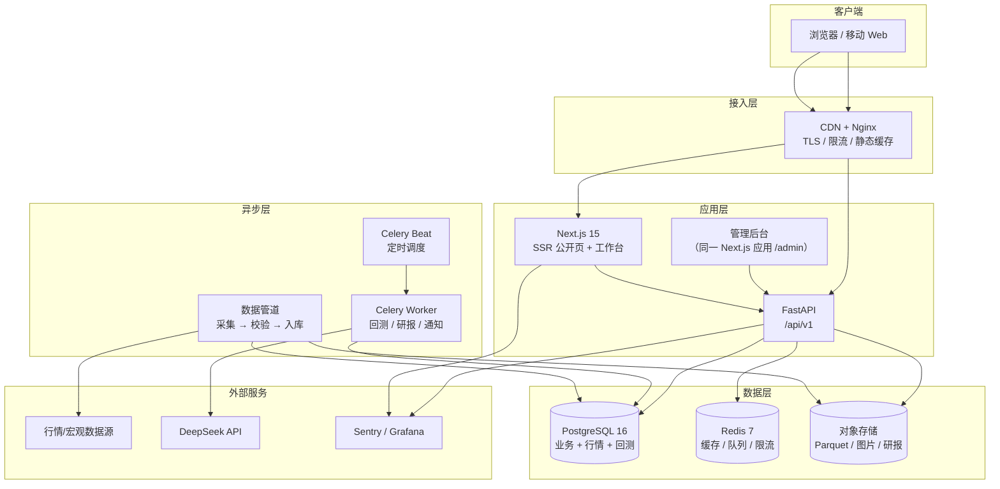

# StockLab · 完整开发计划

| 项目 | 内容 |
|---|---|
| 文档版本 | v2.0 |
| 制定日期 | 2026-10-21 |
| 当前阶段 | V2 个股模块已上线，进入运维与商业化完善 |
| 参考产品 | [稳稳地赢 wenwendeying.com](https://wenwendeying.com/) |
| 代码仓库 | `git@github.com:iamlay/stock.git` |
| 经营主体 | 暂无（过渡方案见第 17 节） |
| 文档定位 | 项目唯一事实来源（SSOT），每次迭代评审后更新 |

> **阅读指引**：第 0 节是一页纸摘要；研发从第 3、4、5 节开始；排期看第 7 节；测试与上线看第 9、14 节；合规与风险看第 10、13 节；无主体如何变现看第 17 节；**V2 个股与后续未完成功能看第 18 节**。

---

## 0. 一页纸摘要

### 0.1 做什么

面向中国个人投资者的 **ETF 投研看板 + 策略回测工具 + 个股股息率模块**，以订阅制变现：

> 2026-10-21 更新：V2 已扩展 A 股个股模块（5,000 只、股息率排序、自选、K 线、质量检查）。本节原始描述以 ETF MVP 为主，个股范围见第 18 节。

1. **今日市场**：市场温度、板块热力、估值分位、宏观数据（社融 / PMI / CPI），每个指标配"怎么读"。
2. **ETF 中心**：红利、现金流、跨境、宽基、行业五大类；列表、详情、同类对比、份额与折溢价。
3. **策略实验室**：规则透明、参数可调的日频策略回测，输出净值曲线、买卖点、交易明细与下一交易日推演。
4. **内容与 AI 研报**：ETF 百科、策略说明、深度文章、AI 辅助研报（人工审核后发布）。
5. **会员与运营后台**：注册登录、邀请/兑换码、会员开通、协议签署、数据管道监控。

### 0.2 不做什么（Non-goals）

- ❌ 不做实盘下单、代客理财、收益承诺、公开荐股。
- ❌ 不做 Level-2 / 高频 / 毫秒级行情。
- ❌ MVP 不做社区评论、跟单、直播。
- ❌ **不提供微信登录与微信支付**（任何版本）：登录仅手机号，会员仅通过兑换码开通。
- ❌ 不做原生 App（先 Web，V2 再评估小程序）。

### 0.3 怎么赢

参考产品已经验证了"数据 + 策略 + 内容 + 社群"的付费模式，但仍有四个空位：

| 空位 | 我们的做法 |
|---|---|
| **SEO 弱**（纯 SPA，搜索引擎收录差） | Next.js SSR + 结构化数据 + 每只 ETF 独立落地页，用内容做自然流量 |
| **口径黑箱** | 每个指标附定义、样本区间、数据来源、更新时间；策略附完整成交假设 |
| **回测可信度** | 默认 T+1 开盘成交，杜绝"收盘信号、收盘成交"的未来函数；内置样本外与手工核对用例 |
| **移动端重** | 移动优先布局，首屏 LCP < 2s，弱网可用 |

### 0.4 怎么落地

- **技术**：Next.js 15 + FastAPI + PostgreSQL + Redis；回测引擎用 Python 自研（日频）；单仓 monorepo；Docker Compose 部署阿里云。
- **团队**：2 人等效全职（1 全栈前端 + 1 后端/数据），设计 0.3 人，QA/运维 0.2 人。
- **节奏**：14 周 / 4 个阶段（P0–P3）/ 6 个双周 Sprint；W10 范围冻结。
- **商业化**：站内不做在线支付，采用"邀请制 + 兑换码 + 第三方平台代收"；不接微信登录/支付（见第 17 节）。
- **预算**：一次性约 ¥1,000（域名、认证、数据源），月度约 ¥900–1,200。

### 0.5 里程碑

| 里程碑 | 时间 | 交付 |
|---|---|---|
| M0 立项与基建 | W1（10/19–10/25） | 仓库、CI、数据源验证、交互原型 |
| M1 数据 + 行情 MVP | W2–W4（至 11/15） | 数据管道、今日市场、ETF 列表 |
| M2 ETF + 账户 | W5–W6（至 11/29） | 20 只 ETF 详情、对比、自选、登录 |
| M3 策略实验室 | W7–W9（至 12/20） | 回测引擎、9 个策略、策略看板 |
| M4 商业化 | W10–W11（至 01/03） | 兑换码、会员开通、协议、后台 |
| M5 上线 | W12–W14（至 01/22） | AI 研报 Beta、SEO、压测、灰度发布 |

### 0.6 成功标准（上线 3 个月）

- 注册 → 激活（7 日内完成 1 次自选或回测）≥ 40%；
- 内测首批 50 名用户 7 日留存 ≥ 50%；
- 第三方渠道付费 ≥ 30 人（验证付费意愿）；
- 数据完整率 ≥ 99.5%，每日 18:30 前完成更新；
- API p95 < 300ms，首页 LCP < 2s，可用性 ≥ 99.5%。

### 0.7 已确认决策（2026-10-19）

| 决策 | 结论 | 对计划的影响 |
|---|---|---|
| 产品范围 | **MVP 只做 ETF**，个股延至 V2 | 数据模型仍预留 `stock` 类型，但不做个股页面、个股筛选与个股策略；20 只重点 ETF 清单冻结 |
| 经营主体 | **暂无个体户 / 公司** | 不接微信登录/支付；改用"邀请制 + 兑换码 + 人工开通" |
| 变现路径 | 先验证付费意愿，站内不收款 | 第三方知识付费平台代收并发放兑换码；站内只做兑换与权益 |
| V2 范围（2026-10-21） | **新增 A 股个股模块**：全市场 5,000 只、股息率排序、自选、K 线、行业、质量检查 | ETF MVP 不变；个股功能与未完成项见第 18 节 |

> 结论：**范围不变、排期不变，把"微信登录 / 站内支付"整体移出产品**，避免资质与支付通道阻塞上线。

---

## 1. 背景与对标分析

### 1.1 参考产品拆解

> 说明：以下基于其公开页面、前端路由与文案的观察，未接触内部实现；仅用于产品与架构参考，不做像素级复制。

| 维度 | 稳稳地赢的做法 | 启示 |
|---|---|---|
| **定位** | "稳健 ETF 投资看板与社群"，强调控制回撤、红利/现金流 | 切口要窄，"稳健"是心智锚点 |
| **用户** | 有积蓄、厌恶回撤、没时间盯盘的上班族 | 内容必须"可解释"，降低理解门槛 |
| **功能地图** | 今日市场（温度/热力/估值/宏观）；ETF 四类 Hub；20+ 只重点 ETF 详情；策略看板（20+ 规则策略 + 回测明细）；AI 研报；组合实验室；资讯/深度文章；站内信 | 数据、策略、内容三位一体；**详情页是留存核心** |
| **商业化** | 多档订阅 + 微信试用码 + 公众号/社群 + 管理员微信 | 试用码是低成本获客；社群承担续费与答疑 |
| **技术特征** | React SPA + REST API + 独立数据管道 + Grafana Faro 埋点 + 后台"同步看板" | 数据管道与后台可观测性是隐形成本 |
| **体验** | 信息密度高、图表重、术语多 | 我们做"结论先行 + 口径说明 + 移动优先" |

**可改进点**（也是我们的差异化）：

1. SPA 首屏慢、SEO 几乎为零，浪费了 ETF 长尾搜索流量。
2. 回测以"信号当日收盘价"成交，存在未来函数嫌疑，且未充分披露滑点/停牌/涨跌停处理。
3. 指标口径与数据来源披露不足，用户难以判断可信度。
4. 移动端信息密度过高，新用户上手成本大。

### 1.2 目标用户与场景

| Persona | 画像 | 核心诉求 | 关键功能 | 付费意愿 |
|---|---|---|---|---|
| **稳健配置型** 老周 | 38 岁，可投资产 50–200 万，银行理财搬家 | 少亏、有现金流、别天天盯盘 | 红利/现金流 ETF、估值分位、回撤对比、月度策略 | 高（年付） |
| **策略学习型** 小林 | 30 岁，程序员，喜欢回测 | 规则透明、能改参数、能验证 | 策略实验室、交易明细、导出 | 中高（月付转年付） |
| **内容读者** 张姐 | 45 岁，从搜索/公众号进入 | 先看懂，再决定 | ETF 百科、文章、免费工具 | 低转高（试用码） |

### 1.3 产品原则

1. **结论先行**：每个页面首屏给出"今天发生了什么、意味着什么"，再给图表。
2. **口径可查**：任何数字都能点开看到定义、区间、来源、更新时间。
3. **不预测、不荐股**：只做规则推演与历史统计，所有策略标注"非实盘建议"。
4. **移动优先**：390px 宽度下完成 90% 的核心任务。
5. **慢即是快**：宁可少一个功能，不可错一个数字。

---

## 2. 范围与优先级

### 2.1 版本规划

| 模块 | MVP（W1–W6） | V1（W7–W11） | V2（上线后 3 个月） |
|---|---|---|---|
| 今日市场 | 温度、涨跌分布、成交额、板块热力、估值概览 | 宏观卡片（社融/PMI/CPI）、股债利差 | 北向/资金流（若数据可得）、自定义看板 |
| ETF 中心 | 5 大类、20 只重点 ETF 列表 + 详情 | 全市场筛选、同类对比、份额/折溢价 | 提醒、持仓穿透、组合实验室 |
| 策略实验室 | — | 9 个策略、回测、明细、推演 | 20+ 策略、参数寻优、自定义组合 |
| 账户 | 手机号登录、邀请码/兑换码、人工开通 | 手机号 + 邀请体系 | 邀请返利、发票、团队版 |
| 内容 | 静态 About/条款 | 文章 CMS、AI 研报 Beta | AI 研报正式、音频/视频 |
| 后台 | — | 用户/订单/内容/数据任务 | 运营看板、A/B 实验 |
| 社区 | — | 站内信 | 评论、问答（合规评估后） |

### 2.2 范围调节阀

若进度落后（W8 评审触发），按顺序砍：

1. AI 研报 Beta → 延至 V2；
2. 组合实验室 → 延至 V2；
3. 策略数量 9 → 6（保留买入持有、定投、双均线、RSI、布林、网格）；
4. 跨境/行业 Hub → 只保留红利 + 宽基。

**不可砍**：数据正确性、兑换开通闭环、合规声明、监控告警。

### 2.3 合规红线

- 不展示"稳赚""必涨""收益承诺"类文案；不提供买卖点推荐。
- 所有回测页固定展示："历史回测，非实盘承诺，不构成投资建议。"
- 不代客操作账户，不接触用户资金（站内不收款，交易由第三方平台承接）。
- 行情数据仅用于展示与分析，不提供批量下载/转售。

---

## 3. 技术架构

### 3.1 总体架构



### 3.2 技术选型

| 层 | 选型 | 理由 | 备选（何时切换） |
|---|---|---|---|
| Web 框架 | **Next.js 15 App Router** | 公开页 SSR/ISR 解决 SEO；RSC 降低首屏 JS | Remix（团队更熟时） |
| UI | React 19 + TypeScript + Tailwind 4 + shadcn/ui | 开发快、可定制、无锁定 | Ant Design（后台偏重时） |
| 图表 | ECharts 5（按需引入） | K 线、热力、缩放能力成熟 | TradingView Lightweight（仅 K 线） |
| 数据请求 | TanStack Query 5 + RSC | 缓存/重试/乐观更新 | SWR |
| 状态 | Zustand（仅 UI 态） | 轻量，服务端状态交给 Query | — |
| API | **FastAPI + Pydantic v2** | 量化生态在 Python；OpenAPI 自动生成 | NestJS（团队全 TS 时） |
| ORM | SQLAlchemy 2 + Alembic | 成熟、迁移可控 | — |
| 数据库 | **PostgreSQL 16** | 关系 + JSONB + 窗口函数 + pgvector 一库搞定 | ClickHouse（Tick 级数据时） |
| 缓存/队列 | Redis 7 + Celery 5 | 回测/研报异步化 | Arq / Dramatiq |
| 计算 | Polars + NumPy + Pandas | 向量化指标计算快 | — |
| 回测 | **自研日频引擎** | T+1、停牌、涨跌停、分红再投等 A 股规则需完全可控 | vectorbt（研究用，不上生产） |
| AI | DeepSeek API + pgvector | 成本低、中文好；RAG 保证引用可追溯 | 通义/豆包（多供应商降级） |
| 部署 | Docker Compose + 阿里云 ECS | 2 人团队运维成本最低 | K8s（多实例后） |
| CI/CD | GitHub Actions + GHCR | 与仓库天然集成 | — |
| 监控 | Sentry + Prometheus/Grafana + UptimeRobot | 错误、指标、可用性三层 | 阿里云 ARMS |

### 3.3 仓储结构

```text
stock/
├─ apps/
│  ├─ web/                     # Next.js
│  │  ├─ app/
│  │  │  ├─ (marketing)/       # 首页、定价、关于（SSR）
│  │  │  ├─ (app)/             # 工作台、ETF、策略（登录态）
│  │  │  ├─ admin/             # 管理后台
│  │  │  └─ api/               # BFF：仅登录态转发与 Cookie 处理
│  │  ├─ components/
│  │  ├─ lib/
│  │  └─ e2e/                  # Playwright
│  └─ api/
│     ├─ app/
│     │  ├─ api/v1/            # 路由
│     │  ├─ core/              # 配置、安全、日志
│     │  ├─ models/            # SQLAlchemy
│     │  ├─ schemas/           # Pydantic
│     │  ├─ services/          # 业务逻辑
│     │  └─ tasks/             # Celery
│     ├─ alembic/
│     └─ tests/
├─ packages/
│  ├─ quant/                   # 回测引擎（可独立安装）
│  │  └─ stock_quant/
│  │     ├─ data.py
│  │     ├─ indicators.py
│  │     ├─ engine.py
│  │     ├─ metrics.py
│  │     └─ strategies/
│  ├─ contracts/               # OpenAPI → TS 类型与客户端
│  └─ ui/                      # 共享组件（图表、卡片、空态）
├─ etl/
│  ├─ sources/                 # tushare / akshare / 交易所
│  ├─ jobs/                    # daily_bars / shares / valuation / macro
│  ├─ quality/                 # 校验规则
│  └─ dags/                    # 调度定义
├─ infra/
│  ├─ docker/                  # Dockerfile、compose
│  ├─ nginx/
│  └─ scripts/                 # 部署、备份、补数
├─ docs/
│  ├─ DEVELOPMENT_PLAN.md      # 本文件
│  ├─ adr/                     # 架构决策记录
│  ├─ api/                     # 接口说明（OpenAPI 导出）
│  └─ runbook/                 # 故障处理手册
└─ .github/
   ├─ workflows/               # ci.yml、deploy.yml
   └─ ISSUE_TEMPLATE/
```

### 3.4 关键架构决策（ADR 摘要）

| 编号 | 决策 | 理由 | 代价 |
|---|---|---|---|
| ADR-001 | 公开页用 SSR/ISR，工作台用 CSR | 解决 SEO 与首屏；工作台交互重，SSR 收益低 | 两套渲染心智，需明确边界 |
| ADR-002 | 后端用 Python/FastAPI | 数据管道、回测、指标计算同一语言，避免双份逻辑 | 与前端类型需靠 OpenAPI 打通 |
| ADR-003 | 回测引擎自研 | A 股 T+1/涨跌停/停牌/分红规则必须精确；第三方库难改 | 前期投入约 12 人日，需严格测试 |
| ADR-004 | 单库 PostgreSQL 起步 | 数据量（日频，十年约百万行）远未到分库必要 | 后期 Tick 数据需引入 ClickHouse |
| ADR-005 | 模块化单体，不上微服务 | 2 人团队，运维复杂度是最大敌人 | 需靠目录与依赖规则约束边界 |
| ADR-006 | 站内不做支付，会员只走兑换码 | 无主体、无支付牌照；减少对账/退款/合规成本 | 续费依赖提醒，转化链路更长 |
| ADR-007 | 数据"授权优先、公开源兜底" | 降低版权与断供风险 | 成本上升，需做多源适配层 |

### 3.5 环境与部署拓扑

| 环境 | 用途 | 配置 | 数据 |
|---|---|---|---|
| local | 开发 | Docker Compose（PG/Redis） | 近 2 年样本 |
| staging | 预发/验收 | 同生产单机，独立 compose project | 全量只读副本 |
| prod | 生产 | ECS 4C8G + RDS PG 2C4G + Redis 1G | 全量 |

发布流程：`main` 合并 → CI 构建镜像 → 推送 GHCR → SSH 到服务器 `docker compose pull && up -d` → 健康检查 `/healthz` → 失败自动回滚上一 tag。

---

## 4. 数据体系

### 4.1 数据源清单

| 数据 | 主源 | 备源 | 频率 | 授权/成本 | 风险 |
|---|---|---|---|---|---|
| ETF/股票日线（OHLCV） | Tushare Pro | 交易所官网、AkShare | 日频 17:00 | 积分制，约 ¥500/年 | 积分规则变动 |
| 实时快照 | 腾讯行情 | 新浪、东财 | 5–15 秒 | 公开接口 | 非授权、限频、字段变动 |
| ETF 份额/规模 | 交易所 | 东财 | 日频 18:00 | 公开 | 延迟一日 |
| 基金净值/IOPV | 基金公司/交易所 | 东财 | 日频 | 公开 | 部分场外净值 T+1 |
| 指数估值（PE/PB/分位） | 中证指数官网 | 申万、自算 | 日频 | 公开（需注明来源） | 历史区间口径差异 |
| 股息率 | 中证指数/自算 | — | 日频 | 公开 | 分红实施日口径 |
| 宏观（社融/PMI/CPI/M2） | 国家统计局、央行 | 东财 | 月频 | 公开 | 发布日不一致 |
| 国债收益率 | 中国货币网 | 东财 | 日频 | 公开 | — |
| 基金持仓 | 基金季报 | 交易所 | 季频 | 公开 | 滞后 15–45 天 |
| 公告 | 巨潮资讯 | 交易所 | 日频 | 公开 | 抓取频率限制 |
| 新闻/资讯 | RSS + 合作方 | — | 实时 | 版权风险 | **MVP 不做**，V2 评估 |
| 北向资金 | 交易所披露 | — | 日频 | 公开 | 2024-08 起取消实时净流入，**仅作 V2 备选** |

**原则**：

1. 所有外部数据先落 ODS（原始文件），再解析入库，保证可回溯、可重放。
2. 每个数据源封装 `SourceAdapter` 接口，主备切换只改配置。
3. 页面上标注"数据来源 + 更新时间"，估值类标注"口径"。
4. 不抓取需要登录/付费墙/明确禁止抓取的数据。

### 4.2 数据分层

```text
ODS（原始层）   交易所/数据源原始 JSON、CSV、Parquet → OSS，按 dt 分区
   ↓
DWD（明细层）   清洗、去重、复权因子、交易日历对齐 → PostgreSQL
   ↓
DWS（汇总层）   估值分位、份额变动、板块聚合、策略指标 → PostgreSQL / Parquet
   ↓
ADS（应用层）   API 直接读取的宽表与物化视图 → PostgreSQL
```

### 4.3 核心数据模型

| 表 | 说明 | 主键 | 预估量级 |
|---|---|---|---|
| `instruments` | 标的字典（ETF/指数/股票） | `code` | 1 万 |
| `trading_calendar` | 交易日历 | `trade_date` | 1 万 |
| `market_daily` | 日线行情（按年分区） | `(code, trade_date)` | 500 万 |
| `etf_profile` | ETF 静态信息（费率、跟踪指数、上市日） | `code` | 1,000 |
| `etf_share_daily` | 份额、规模、折溢价 | `(code, trade_date)` | 100 万 |
| `index_valuation` | 指数 PE/PB/股息率/分位 | `(code, trade_date)` | 100 万 |
| `macro_series` | 宏观指标长表 | `(series_id, period)` | 1 万 |
| `strategies` | 策略定义与默认参数 | `id` | 50 |
| `backtest_runs` | 回测任务与绩效 | `id` | 10 万 |
| `backtest_equity` | 净值曲线 | `(run_id, trade_date)` | 千万级（按需清理） |
| `backtest_trades` | 成交明细 | `(run_id, seq)` | 千万级 |
| `users` / `subscriptions` / `orders` | 账户与商业化 | `id` | 十万 |
| `articles` / `ai_reports` | 内容 | `id` | 千 |
| `data_jobs` / `data_quality_checks` | 管道可观测 | `id` | 十万 |

> 完整 DDL 草案见 [附录 B](#附录-b核心表-ddl-草案)。

### 4.4 调度与数据质量

| 时间 | 任务 | 失败处理 |
|---|---|---|
| 15:05 | 收盘快照、涨跌分布 | 重试 3 次（间隔 1/5/15 分钟） |
| 15:30 | 当日日线（主源） | 切备源，仍失败则告警 |
| 17:30 | 指数估值、股息率 | 重试 + 沿用上一日并标记 |
| 18:00 | ETF 份额、规模、折溢价 | 重试；缺失则页面显示"待更新" |
| 18:30 | 指标计算（分位、聚合）、缓存预热 | 告警；不阻塞已发布数据 |
| 19:00 | 数据质量校验、日报 | 生成质量报告，异常发企微/邮件 |
| 每月 15 日 | 宏观数据（社融/PMI/CPI） | 按发布日历触发 |

**质量规则**（任一失败即告警，严重则阻断发布）：

- 行数波动 > 20%（与近 5 日均值比）；
- 价格 ≤ 0、`high < low`、`close` 超出 `[low, high]`；
- 单日涨跌幅 > ±20%（ETF）触发人工复核；
- 主键重复、交易日不在日历内；
- 份额环比变动 > 50%（防单位错误）；
- 复权因子单调性校验；
- 关键指标连续 3 日为 NULL。

### 4.5 指标口径（必须与页面文案一致）

| 指标 | 定义 | 注意事项 |
|---|---|---|
| 涨跌幅 | `close / prev_close - 1`，使用前复权价 | 分红除权日需复权 |
| 估值分位 | 当前 PE 在近 N 年（默认 5 年）有效样本中的百分位 | 剔除负值；样本 < 250 日不展示 |
| 股息率 | 近 12 个月现金分红 / 总市值 | 注明"近 12 个月" |
| 份额变动 | 当日份额 − 前一交易日份额 | 单位统一为"万份" |
| 折溢价率 | 二级市场价格 / IOPV − 1 | 收盘后用净值近似，标注 |
| 股债利差 | 沪深 300 盈利收益率 − 10 年期国债收益率 | 盈利收益率 = 1/PE |
| 最大回撤 | `min(净值 / 历史峰值 − 1)` | 区间起点为回测起点 |
| 年化收益 | `(期末/期初)^(365/天数) − 1` | 不足 1 年标注"年化参考" |
| 拥挤度 | 份额增速在近 60 日窗口的分位 | 仅用于策略风控说明 |

---

## 5. 功能模块设计

### 5.1 账户、会员与兑换

**目标**：60 秒内完成"登录 → 输入兑换码 → 进工作台"；站内不收款、不接微信。

| 项 | 设计 |
|---|---|
| 登录 | 手机号 + 短信验证码（唯一登录方式，不接微信扫码） |
| 会话 | Access JWT 15 分钟（内存）+ Refresh 30 天（httpOnly、SameSite=Lax、轮换） |
| 角色 | `anonymous` / `trial` / `member` / `admin` |
| 邀请 / 试用 | 邀请码即试用码：批次（渠道、有效期、绑定用户、一次性）、7 天全功能、到期自动降级 |
| 会员开通 | **兑换码**：第三方平台售出后发码，用户在 `/redeem` 兑换；后台可人工开通 / 延期 |
| 支付 | **站内不做支付**：不接微信支付、支付宝，不出现购买按钮；会员一律通过兑换码开通 |
| 协议 | 首次登录签署《用户协议》《隐私政策》《免责声明》；版本化留痕（时间、IP、UA） |
| 续费 | 到期前 7/3/1 天站内信 + 邮件；续费即再次兑换 |
| 退款 | 由第三方平台按其规则处理；站内不涉及资金流 |

**关键接口**：`POST /auth/sms-code`、`POST /auth/login`、`POST /auth/refresh`、`GET /me`、`POST /redeem`、`GET /plans`、`GET /subscriptions/current`。

**验收**：

- 新用户从落地页到进入工作台 ≤ 3 步、≤ 60 秒；
- 同一兑换码并发兑换 10 次，只成功 1 次（唯一约束 + 行锁）；
- 会员到期后 1 分钟内 API 返回 402，前端引导兑换；
- 全站不出现微信登录、微信支付、在线购买入口；价格页只说明第三方获取方式；
- 协议未签署时，除登录 / 协议页外全部拦截。

### 5.2 今日市场（Dashboard）

| 区块 | 内容 | 数据依赖 |
|---|---|---|
| 市场温度 | 上涨/平盘/下跌家数、成交额、涨停/跌停、5 日均对比 | 日线、涨跌停统计 |
| 板块热力 | 申万一级/二级 Treemap，当日及 5/20 日涨幅 | 行业指数日线 |
| 估值概览 | 沪深 300 / 中证 500 / 红利低波 PE、PB、分位、股债利差 | 指数估值、国债收益率 |
| 宏观卡片 | 社融、PMI、CPI/PPI、外储；配"怎么读"折叠说明 | 宏观长表 |
| 指数走势 | 上证/沪深 300/创业板指 K 线 + 均线 | 日线 |
| 重点 ETF | 按涨跌幅排序的 20 只卡片，可切换净值/份额 | ETF 行情 + 份额 |

**交互**：日期切换（最近 20 个交易日）；图表懒加载；移动端单列卡片。

**验收**：18:30 前数据就绪；抽样 10 个数字与交易所/Tushare 一致；首屏 LCP < 2s。

### 5.3 ETF 中心

**分类**：红利、现金流、跨境、宽基、行业（V2 增加商品、债券）。

| 页面 | 内容 |
|---|---|
| 分类 Hub | 该类核心逻辑、代表 ETF 对比表、相关策略、常见问题 |
| 列表 | 代码/名称/涨跌幅/规模/份额/股息率/估值分位/折溢价；排序、筛选、搜索 |
| 详情 | K 线 + 净值、IOPV/折溢价、份额与规模趋势、跟踪指数估值、前十大持仓、费率、分红历史、同类对比、相关策略 |
| 对比 | 最多 5 只，归一化净值、回撤、波动率、相关性 |

**SEO**：每只 ETF 独立 URL `/etf/{code}`，SSR 输出标题/描述/JSON-LD（FinancialProduct），自动生成 sitemap；内容包含"是什么/怎么买/费率/风险"。

**验收**：20 只重点 ETF 字段完整率 100%；详情页 LCP < 2s；Google/百度收录正常（上线 2 周后检查）。

### 5.4 策略实验室

**目标**：让用户"看懂规则 → 改参数 → 看结果 → 知道下一步"。

**页面**：

1. **策略列表**：按总收益/最大回撤/夏普排序；筛选（类型、标的、仓位方式）；展示净值缩略图。
2. **策略详情**：
   - 顶部结论卡：总收益、年化、最大回撤、夏普、卡玛、交易次数；
   - 净值曲线 vs 基准（买入持有）+ 回撤水下图；
   - K 线叠加买卖点（可开关）；
   - 交易明细表（日期、方向、价格、金额、份额、持有天数、收益）；
   - 参数面板（改动后"重新回测"）；
   - 规则说明（白话 + 成交假设 + 风险提示）；
   - **下一交易日推演**：按最新收盘数据判断是否会触发信号，注明"非下单指令"。
3. **回测任务**：异步执行，前端轮询/SSE 展示进度；结果缓存 24 小时。

**引擎规格**：

| 项 | 规则 |
|---|---|
| 频率 | 日频，收盘后计算信号 |
| 成交时点 | **T+1 开盘价**（默认）；可切换 T 日收盘（对照模式，显著标注偏差） |
| 成本 | 佣金 0.02%（最低 5 元）、滑点 2bp；ETF 无印花税 |
| 约束 | T+1、100 份整数倍、停牌不可成交、开盘涨跌停不成交 |
| 复权 | 后复权计算收益；分红再投 |
| 基准 | 标的买入持有；可选沪深 300 |
| 样本外 | 默认留出最近 1 年，结果页分"样本内/样本外"展示 |

**9 个 MVP 策略**（详见[附录 C](#附录-c策略清单)）：买入持有、每月定投、偏离度分层定投、双均线、MACD、RSI 分位、布林带、等距网格、偏离度调仓。

**正确性验证**：

1. 手工用例 3 个（单笔买卖、定投 12 期、网格穿越 5 次），逐笔核对金额与份额；
2. 买入持有 510300（2020-01-02 至 2024-12-31）与累计净值涨幅误差 < 0.5%；
3. 随机 50 组参数跑通，无负资产、无未来数据（信号日 < 成交日断言）；
4. 性能：单策略 10 年回测 < 2s；批量 100 组 < 60s（异步）。

**验收**：任一策略页可完成"看结论 → 改参数 → 重跑 → 看明细"闭环；所有成交可追溯到日线数据。

### 5.5 自选与组合

| 功能 | 版本 | 说明 |
|---|---|---|
| 自选分组 | MVP | 默认分组 + 自定义；拖拽排序；批量导入代码 |
| 涨跌提醒 | V1.1 | 站内信/邮件，阈值或百分比 |
| 模拟组合 | V2 | 建仓、调仓、收益归因、再平衡建议（不接实盘） |

### 5.6 内容与 AI 研报

- **文章**：Markdown 存储，支持付费墙（`is_premium`）、标签、相关 ETF 关联、目录、代码高亮。
- **AI 研报（V1 Beta）**：输入 ETF → 聚合行情/估值/份额/公告 → 结构化 Prompt → 生成"近期表现 / 资金与份额 / 估值位置 / 风险点 / 数据附录" → 敏感词与事实校验 → 人工审核 → 发布。
- **成本控制**：单篇 token 上限 8k；每用户每日 3 篇；结果缓存 24h；失败降级为模板报告。
- **合规**：AI 内容显著标注"AI 辅助生成，已人工审核"；不出现买卖建议。

### 5.7 消息与通知

| 渠道 | 场景 | 版本 |
|---|---|---|
| 站内信 | 到期提醒、兑换成功、系统公告 | MVP |
| 邮件 | 周报、到期提醒 | V1.1 |

### 5.8 管理后台

| 模块 | 功能 |
|---|---|
| 用户 | 搜索、详情、角色调整、封禁、邀请码/兑换码生成与导出 |
| 订单/订阅 | 查询、兑换记录、补单/延期、退款标记、对账导出 |
| 内容 | 文章 CRUD、AI 研报审核、置顶 |
| 数据管道 | 每次任务状态/耗时/行数/校验结果；手动触发与补数 |
| 运营 | 访问统计（PV/UV/转化漏斗）、渠道码效果 |
| 配置 | 公告、客服邮箱、试用开关、功能灰度 |

### 5.9 埋点与增长

- **方案**：自建 `events` 表 + Umami（自托管，隐私友好）；不引入重型 SDK。
- **核心事件**：`page_view`、`signup`、`invite_redeem`、`backtest_run`、`paywall_hit`、`member_redeem`、`renew`。
- **漏斗**：落地页 → 登录 → 邀请码 → 首次回测 → 兑换会员 → 续费。
- **原则**：不采集敏感信息；提供关闭选项；数据保留 180 天。

---

## 6. 接口设计规范

- **风格**：REST，前缀 `/api/v1`，JSON；OpenAPI 3.1 自动生成并导出到 `docs/api/openapi.json`。
- **认证**：`Authorization: Bearer <access>`；刷新走 httpOnly Cookie。
- **分页**：`?limit=20&cursor=xxx`，返回 `{ "items": [], "next_cursor": null }`。
- **错误**：RFC 9457 Problem Details。

```json
{
  "type": "https://stocklab.dev/errors/plan-required",
  "title": "需要会员权限",
  "status": 402,
  "detail": "当前试用已到期，请续费后使用策略回测。",
  "trace_id": "01J8Z3K9V6"
}
```

- **限流**：Redis 令牌桶；匿名 60 req/min，登录 300 req/min，回测 20 次/日（标准版）。
- **幂等**：兑换核销与后台开通接口要求 `Idempotency-Key`。
- **缓存**：行情 5s、列表 60s、详情 300s；`ETag` + `Cache-Control`。
- **版本**：破坏性变更升 `/v2`，旧版保留 6 个月。

**接口清单（节选）**：

| 方法 | 路径 | 说明 | 权限 |
|---|---|---|---|
| POST | `/auth/sms-code` | 发送验证码 | 匿名 |
| POST | `/auth/login` | 手机号登录 | 匿名 |
| POST | `/auth/refresh` | 刷新令牌 | Cookie |
| GET | `/me` | 当前用户与权益 | 登录 |
| GET | `/plans` | 套餐与权益（不含在线购买） | 公开 |
| POST | `/redeem` | 兑换邀请码 / 会员码 | 登录 |
| GET | `/market/overview` | 市场温度与涨跌分布 | 登录/试用 |
| GET | `/market/heatmap` | 板块热力 | 登录/试用 |
| GET | `/market/valuation` | 估值与股债利差 | 登录/试用 |
| GET | `/market/macro` | 宏观序列 | 登录/试用 |
| GET | `/etfs` | ETF 列表（筛选/排序） | 登录/试用 |
| GET | `/etfs/{code}` | ETF 详情 | 登录/试用 |
| GET | `/etfs/{code}/shares` | 份额与规模 | 登录/试用 |
| GET | `/etfs/compare?codes=` | 多只对比 | 会员 |
| GET | `/watchlists` | 自选分组 | 登录 |
| POST | `/watchlists/{id}/items` | 添加自选 | 登录 |
| GET | `/strategies` | 策略列表 | 会员 |
| GET | `/strategies/{slug}` | 策略详情与默认参数 | 会员 |
| POST | `/backtests` | 提交回测（异步） | 会员 |
| GET | `/backtests/{id}` | 回测结果 | 会员 |
| GET | `/backtests/{id}/trades` | 成交明细 | 会员 |
| GET | `/articles` | 文章列表 | 公开 |
| GET | `/articles/{slug}` | 文章详情 | 公开/会员 |
| GET | `/messages` | 站内信 | 登录 |
| GET | `/admin/stats` | 运营概览 | 管理员 |
| GET | `/admin/jobs` | 数据任务状态 | 管理员 |

---

## 7. 里程碑与排期

### 7.1 总览

| 阶段 | 周次 | 日期 | 主题 | 出口标准 |
|---|---|---|---|---|
| **P0** | W1 | 10/19–10/25 | 立项与基建 | 仓库可 CI、数据源连通、原型定稿 |
| **P1** | W2–W6 | 10/26–11/29 | 数据 + 行情 + ETF + 账户 | 内测可看全量行情与 20 只 ETF |
| **P2** | W7–W11 | 11/30–01/03 | 策略 + 会员 + 后台 | 付费闭环跑通，策略可回测 |
| **P3** | W12–W14 | 01/04–01/22 | 内容 + 打磨 + 上线 | 公测上线，监控就绪 |

### 7.2 周计划

| 周 | 日期 | 交付物 | 验收 |
|---|---|---|---|
| W1 | 10/19–10/25 | 仓库初始化、CI、Docker 基线；数据源验证脚本；页面原型（首页/工作台/ETF/策略）；20 只 ETF 清单冻结；**主体路径决策**（个体户 / 第三方平台） | `main` 可构建；10 年日线可入库；原型评审通过；变现方案定稿 |
| W2 | 10/26–11/01 | 数据管道：日线、交易日历、标的字典；质量校验框架；部署 staging | 近 10 年数据完整率 ≥ 99%；每日任务可重跑 |
| W3 | 11/02–11/08 | 估值、份额、宏观数据；指标计算（分位、股债利差）；API 骨架 + 鉴权 | 指标抽样核对通过；`/market/*` 可用 |
| W4 | 11/09–11/15 | 今日市场前端（温度/热力/估值/宏观）；响应式与骨架屏 | 手机端可用；LCP < 2.5s；数字抽样一致 |
| W5 | 11/16–11/22 | ETF 列表 + 分类 Hub + 详情页（K 线/份额/估值/持仓） | 20 只详情完整率 100%；SEO 标签齐全 |
| W6 | 11/23–11/29 | ETF 对比、自选；手机号登录 + 邀请码；内测发布 | 内测用户可完成"登录→自选→看详情"；埋点上报 |
| W7 | 11/30–12/06 | 回测引擎核心：数据加载、撮合、账户、指标；3 个基础策略 | 手工用例通过；买入持有与基准误差 < 0.5% |
| W8 | 12/07–12/13 | 9 个策略全部接入；异步任务与结果存储；回测 API | 100 组参数批量跑通；单次 < 2s |
| W9 | 12/14–12/20 | 策略列表/详情前端；买卖点图、明细表、下周推演 | 闭环可用；移动端可读；错误态完整 |
| W10 | 12/21–12/27 | 兑换码 / 会员开通 / 协议签署；权限中间件；**范围冻结** | 兑换码全流程通过；到期降级正确；无任何支付入口 |
| W11 | 12/28–01/03 | 管理后台（用户/订单/内容/任务）；站内信；兑换码批次 | 运营可自助发码、查单、看任务 |
| W12 | 01/04–01/10 | AI 研报 Beta；文章 CMS；SEO（sitemap/JSON-LD/OG）；周报 | 生成 10 篇人工审核通过；收录检查 |
| W13 | 01/11–01/17 | 性能优化、压测、安全扫描、备份演练、监控告警 | p95 < 300ms；无高危漏洞；恢复演练成功 |
| W14 | 01/18–01/22 | 灰度 10% → 50% → 100%；上线文档、客服话术、复盘 | 无 P0/P1 故障；SLA 达标 |

> 注：元旦（01/01）与周末不计工作日；W10 与 W11 跨年，预留 1 天缓冲。

### 7.3 Epic 拆解与工作量

| Epic | 内容 | 人日 | 依赖 | 阶段 |
|---|---|---|---|---|
| E1 | 工程基建（monorepo、CI、Docker、规范） | 6 | — | P0 |
| E2 | 数据管道（采集、清洗、调度、质量、补数） | 12 | E1 | P1 |
| E3 | 行情看板（API + 前端 + 图表） | 10 | E2 | P1 |
| E4 | ETF 中心（列表、详情、对比、SEO） | 10 | E2 | P1 |
| E5 | 回测引擎（撮合、指标、9 策略、测试） | 16 | E2 | P2 |
| E6 | 策略看板（列表、详情、图表、推演） | 8 | E5 | P2 |
| E7 | 账户与商业化（登录、邀请码、兑换、协议） | 10 | E1 | P2 |
| E8 | 内容与 AI（CMS、研报、审核） | 6 | E7 | P3 |
| E9 | 管理后台（用户、订单、内容、任务） | 6 | E7 | P2 |
| E10 | 上线保障（压测、安全、监控、文档） | 8 | 全部 | P3 |
| — | **小计** | **92** | | |
| — | 缓冲 20% | 18 | | |
| — | **合计** | **110** | | |

**产能假设**：2 人 × 14 周 × 5 天 = 140 人日；扣除会议、支持、评审 20% → 112 人日。与 110 基本匹配，**没有余量做 V2 功能**。

### 7.4 研发节奏

- 双周 Sprint：周一计划（30 min）→ 每日站会（10 min）→ 周三 Demo（20 min）→ 周五回顾（30 min）。
- 每周五更新本计划"进度"列与风险登记册。
- W10 范围冻结后，只修 Bug 与合规问题，不加功能。

### 7.5 关键路径

```text
数据源验证 → 日线入库 → 指标计算 → 行情看板
                     ↘ ETF 详情 → 对比/自选 → 内测
数据源验证 → 回测引擎 → 策略库 → 策略看板 → 会员墙
账户/兑换 → 权限 → 后台 → 上线
```

**关键路径上的三个高风险点**：数据源稳定性、回测正确性、兑换码对账。前两个用"双源 + 手工核对"兜底，第三个用批次化与周对账控制。

---

## 8. 工程规范

### 8.1 分支与提交

- **主干开发**：`main` 始终可发布；功能分支 `feat/xxx`、修复 `fix/xxx`、文档 `docs/xxx`，生命周期 ≤ 3 天。
- **提交信息**：Conventional Commits，例如 `feat(etf): add premium rate card`、`fix(backtest): handle suspended days`。
- **PR**：必须关联 Issue；单个 PR ≤ 400 行（不含生成代码）；至少 1 人 Review；Squash Merge。
- **保护**：`main` 禁止直推；CI 全绿才可合并。

### 8.2 代码质量

| 范围 | 工具 | 门槛 |
|---|---|---|
| 前端 | ESLint + Prettier + `tsc --noEmit` | 0 error；禁止 `any`（除第三方边界） |
| 后端 | Ruff + mypy（strict 核心模块）+ pytest | 0 error；核心覆盖率 ≥ 70% |
| 提交 | pre-commit（lint、format、secret 扫描） | 本地拦截 |
| 依赖 | Dependabot + `pip-audit` / `pnpm audit` | 无高危 |

### 8.3 Definition of Done

一个任务只有满足以下全部条件才算完成：

- [ ] 代码合并到 `main`，CI 通过；
- [ ] 单元测试覆盖核心逻辑，边界条件有用例；
- [ ] 接口有 OpenAPI 描述，前端类型由生成器产出；
- [ ] 错误态、空态、加载态齐全；
- [ ] 移动端 390px 验证通过；
- [ ] 涉及数据的，口径与页面文案一致；
- [ ] 涉及用户可见文案的，通过合规检查（无收益承诺）；
- [ ] 文档/变更记录已更新。

### 8.4 文档

- `docs/adr/`：每个重大决策一篇，模板 `背景 / 选项 / 决策 / 后果`。
- `docs/api/`：OpenAPI 导出 + 鉴权说明。
- `docs/runbook/`：数据源故障、兑换异常、发布回滚、证书续期。
- 本计划：每 Sprint 更新进度与风险。

---

## 9. 测试与质量

### 9.1 测试金字塔

| 层级 | 范围 | 工具 | 目标 |
|---|---|---|---|
| 单元 | 指标计算、撮合、权限、金额 | pytest / Vitest | 核心 ≥ 70% |
| 集成 | API + PG + Redis | pytest + testcontainers | 关键路径全覆盖 |
| 合约 | OpenAPI 与前端类型 | openapi-diff | 破坏性变更阻断 |
| E2E | 登录→邀请码→回测→兑换 | Playwright | 10 条关键流程 |
| 数据 | 完整性、口径、及时性 | 自建校验 + 每日报告 | 0 严重异常 |
| 性能 | 首页、行情、回测 | k6 / Lighthouse | 见 9.3 |
| 安全 | 依赖、镜像、越权 | Trivy、ZAP 基线 | 无高危 |

### 9.2 回测专项验证

1. **手工用例**：3 个固定场景，逐笔核对现金流与份额，误差 < 0.01 元。
2. **基准对照**：买入持有 vs 指数累计涨幅，误差 < 0.5%。
3. **无未来函数**：断言每笔成交日期 > 信号日期（T+1 模式）。
4. **边界**：停牌、涨跌停、分红除权、退市、样本不足、全仓/空仓切换。
5. **回归**：策略参数或引擎改动后，固定 20 组结果快照对比，差异需说明。

### 9.3 非功能指标

| 指标 | 目标 |
|---|---|
| 首页 LCP（4G） | < 2.0s |
| 工作台 TTI | < 2.5s |
| API p95 | < 300ms |
| 回测（10 年，单策略） | < 2s |
| 数据更新完成 | 每日 18:30 前 |
| 可用性 | ≥ 99.5%（月度） |
| 错误率 | < 0.5% |

---

## 10. 安全、合规与风控

### 10.1 应用安全

- 全站 HTTPS，HSTS；Cookie `Secure` + `HttpOnly` + `SameSite=Lax`。
- 密码不落地（验证码登录）；短信接口图形/行为验证 + 手机号频控。
- SQL 全部走 ORM/参数化；输出转义防 XSS；管理后台独立角色校验（前端隐藏 + 后端强制）。
- 兑换码核销在事务内完成（行锁 + 唯一约束）；后台开通需二次确认并写审计日志。
- 管理操作审计日志（ who / when / what / IP ）。
- 密钥存环境变量/密钥管理，不入库、不入仓；CI 开启 secret 扫描。
- 备份：PG 每日全量 + WAL 归档，保留 30 天；每季度恢复演练。

### 10.2 合规清单

| 事项 | 要求 | 责任 | 截止 |
|---|---|---|---|
| 经营主体 | 当前无。W1 决策：注册个体工商户（约 ¥0–500，1–2 周）或走第三方平台 | 负责人 | W1 |
| ICP 备案 | 个人主体备案不得用于经营性网站；收费功能建议主体就绪后开放，或由第三方平台承接交易 | 负责人 | W1 启动 |
| 公安备案 | 上线后 30 日内 | 负责人 | 上线后 |
| 第三方平台 | 知识星球 / 小鹅通等代收，平台承担商户资质；确认抽成、结算周期与退款规则 | 负责人 | W2 |
| 用户协议/隐私政策 | 明确收集范围、用途、删除方式 | 产品 | W9 |
| 免责声明 | 每页底部 + 回测页固定提示 | 前端 | 全程 |
| 数据版权 | 优先授权源；页面注明来源；不提供批量下载 | 后端 | 全程 |
| 适当性管理 | V2 评估（风险测评、冷静期） | 产品 | V2 |

### 10.3 内容红线

- 禁止："稳赚""保本""必涨""跟着买"等表述。
- 禁止：具体买卖点位推荐、收益承诺、代客理财暗示。
- AI 生成内容必须人工审核，且标注生成方式与数据截止日。
- 用户可见的策略文案统一使用"规则推演/历史回测/非实盘建议"。

---

## 11. 运维与监控

### 11.1 监控指标

| 类别 | 指标 | 告警阈值 |
|---|---|---|
| 可用性 | `/healthz` 探活 | 连续 2 次失败 |
| 性能 | API p95、5xx 率 | p95 > 800ms 持续 5 min；5xx > 1% |
| 数据 | 最新交易日、任务耗时、校验失败数 | 18:30 未完成；失败 ≥ 1 |
| 队列 | Celery 积压、失败任务 | 积压 > 100；失败 > 5 |
| 资源 | CPU、内存、磁盘、连接数 | > 80% 持续 10 min |
| 业务 | 兑换成功率、登录失败率 | 兑换失败 > 5%；登录失败 > 20% |

### 11.2 发布与回滚

1. 合并 `main` → CI 构建镜像（tag = commit SHA）→ 推送 GHCR。
2. staging 自动部署 + 冒烟测试（Playwright 5 条）。
3. 手动触发生产部署：`docker compose pull && up -d`，滚动重启。
4. 健康检查 60 秒；失败自动回滚上一 tag。
5. 数据库迁移：先兼容（加列/加表），再切换代码，最后清理；禁止破坏性变更与代码同发。

### 11.3 故障预案

| 故障 | 处理 |
|---|---|
| 数据源断供 | 切备源；页面显示"数据延迟"；启用缓存；公告 |
| 兑换码异常 | 冻结可疑批次；按批次对账；人工补发并记录 |
| 回测任务堆积 | 扩容 worker；限流；清理 7 天前结果 |
| 数据库连接耗尽 | 重启 API；检查慢查询；加连接池上限 |
| 证书过期 | 自动续期（acme.sh）+ 到期前 30 天提醒 |

### 11.4 成本估算（月度）

| 项 | 规格 | 费用 |
|---|---|---|
| ECS | 4C8G，40G SSD | ¥250 |
| RDS PostgreSQL | 2C4G，100G | ¥300 |
| Redis | 1G 标准版 | ¥80 |
| OSS + CDN | 50G + 流量 | ¥50 |
| 数据源 | Tushare 积分 | ¥40（年费摊） |
| LLM | DeepSeek，按量 | ¥100–300 |
| 监控/邮件 | 免费额度 | ¥0–50 |
| 域名/证书 | — | ¥10 |
| **合计** | | **¥830–1,080/月** |

一次性：个体户注册 ¥0–500（可选）、设计外包 ¥0–3,000（可选）。

---

## 12. 运营与增长（冷启动）

| 阶段 | 动作 | 目标 |
|---|---|---|
| 上线前 | 10 篇 SEO 文章（ETF 是什么/红利低波怎么选/费率对比）、3 个免费工具（估值分位、ETF 对比、定投计算器） | 收录 50 页 |
| 上线首月 | 公众号导流、邀请码（7 天）、社群答疑、每周市场周报 | 注册 500，试用 150 |
| 第 2–3 月 | 策略公开课（直播/图文）、用户案例、邀请返利（V2） | 付费 50，MRR ¥2,000 |
| 持续 | 每周 2 篇内容、每月 1 次策略更新、季度用户访谈 | 月流失 < 5% |

**过渡期收款（无主体）**：

- 上线前 4 周只做邀请制内测，不收款；
- 首批付费走知识星球 / 小鹅通（年费专栏 + 社群），平台代收后发放兑换码；
- 所有"购买"按钮指向兑换码说明页，**不接个人收款码**；
- 目标：30 人付费验证，再决定是否注册主体（仅用于备案与开票）。

**定价建议**（待验证）：

| 版本 | 价格 | 权益 |
|---|---|---|
| 免费 | ¥0 | 首页、ETF 基础页、每周 1 篇文章 |
| 试用 | 7 天 | 全功能（回测 5 次/日） |
| 标准 | ¥39/月，¥299/年 | 行情 + ETF + 回测 20 次/日 |
| 专业 | ¥69/月，¥599/年 | 无限回测 + AI 研报 + 数据导出 |

> 年付折算约 6.4 折，引导年付；邀请码 / 兑换码按渠道生成，默认 7 天。

---

## 13. 风险登记册

| # | 风险 | 概率 | 影响 | 应对 | 负责人 |
|---|---|---|---|---|---|
| R1 | 行情数据源变更/断供 | 高 | 高 | 双源适配层；每日校验；关键数据落 ODS 可重放 | 后端 |
| R2 | 数据版权/抓取合规 | 中 | 高 | 授权优先；注明来源；不提供下载；法务咨询 | 负责人 |
| R3 | 无主体导致无法开票/企业备案 | 高 | 中 | 第三方平台承接交易与开票；个体户按需注册；不影响产品上线 | 负责人 |
| R4 | ICP 备案周期超预期 | 中 | 中 | W1 提交；先用香港节点内测（不对外开放） | 负责人 |
| R5 | 回测结果不可信 | 中 | 高 | 手工用例 + 基准对照 + 无未来函数断言 + 样本外 | 后端 |
| R6 | 进度延期 | 高 | 中 | W10 冻结；范围调节阀；每周燃尽图 | 产品 |
| R7 | 单人依赖（bus factor） | 中 | 高 | 文档化；关键模块双人 Review；runbook | 负责人 |
| R8 | 付费转化低 | 中 | 高 | 邀请码精细化；首月优惠；社群运营；快速迭代定价 | 产品 |
| R9 | 性能不达标（图表多） | 中 | 中 | 按需加载、服务端聚合、CDN、虚拟列表 | 前端 |
| R10 | 合规处罚（荐股/承诺收益） | 低 | 极高 | 文案审核清单；上线前法务过一遍；AI 内容人工审核 | 产品 |

---

## 14. 上线验收清单

### 14.1 功能

- [ ] 注册/登录/登出/找回（手机号）
- [ ] 邀请码 / 兑换码兑换、到期降级、续费
- [ ] 全站无微信登录、微信支付、在线购买入口
- [ ] 今日市场 6 个区块数据正确
- [ ] 20 只 ETF 详情页完整、对比可用
- [ ] 9 个策略可回测、可改参、可看明细
- [ ] 自选增删改排序
- [ ] 文章发布/付费墙/SEO 标签
- [ ] 后台用户/订单/内容/任务
- [ ] 站内信与到期提醒

### 14.2 非功能

- [ ] Lighthouse 移动端 ≥ 85（首页/详情）
- [ ] API p95 < 300ms（压测 200 并发）
- [ ] 数据 18:30 前更新，连续 7 天无失败
- [ ] 备份可恢复（演练记录）
- [ ] 监控告警可达（电话/企微）
- [ ] 无高危漏洞（Trivy + ZAP）
- [ ] 隐私政策/用户协议/免责声明上线
- [ ] ICP 备案号展示
- [ ] 404/500/空态/弱网均有设计
- [ ] 回滚演练成功

### 14.3 上线后 7 天观察

- 错误率、p95、兑换成功率每小时看板；
- 数据任务每日复盘；
- 用户反馈分类（Bug/体验/内容/付费），24 小时内响应；
- 第 7 天出《上线复盘》，更新本计划 v1.1。

---

## 15. 本周行动清单（Sprint 0）

| 日期 | 任务 | 产出 | 负责 |
|---|---|---|---|
| D1（10/19） | 确认产品范围与命名；**主体路径决策**（个体户 / 第三方平台）；开通第三方知识付费店铺；启动 ICP 资料；申请 Tushare | 决策记录 + 店铺链接 + 备案受理号 | 负责人 |
| D1 | 服务器/域名/SSL；GitHub 仓库保护分支与 Actions | 可访问的 staging 域名 | 后端 |
| D2（10/20） | monorepo 脚手架（web/api/quant）；Docker Compose；CI 跑通 | `main` 绿灯 | 全员 |
| D2 | 设计首页/工作台/ETF 详情/策略详情 4 张高保真图 | Figma 链接 | 设计 |
| D3（10/21） | 数据源验证脚本：拉取 510300 十年日线、估值、份额 | 验证报告 + 样例数据 | 后端 |
| D3 | 冻结首批 20 只 ETF 清单与分类 | `docs/etf-universe.md` | 产品 |
| D4（10/22） | 回测引擎原型：买入持有 + 双均线，跑通 510300 | Notebook + 初步结果 | 后端 |
| D4 | 前端设计系统：颜色、字体、图表主题、移动端栅格 | Storybook 基线 | 前端 |
| D5（10/23） | Sprint 0 评审：范围、排期、风险、预算 | 评审纪要 + 计划 v1.1 | 全员 |

**本周必须拿到的三个答案**：

1. 数据源能否稳定拿到 10 年日线 + 份额 + 估值？（不能则调整范围）
2. 变现能否在无主体下跑通？（第三方平台 + 兑换码；不能则先纯免费内测）
3. 2 人 14 周是否现实？（不现实则按 2.2 砍范围）

---

## 16. 待确认事项（Open Questions）

已确认：**MVP 仅 ETF**、**暂无经营主体**、**不接微信登录/微信支付**（2026-10-19），方案见第 17 节。

| # | 问题 | 影响 | 建议默认 | 决策人 | 截止 |
|---|---|---|---|---|---|
| Q1 | 产品名与域名 | 品牌、备案、SEO | 暂用 StockLab | 负责人 | W1 |
| Q2 | 主体路径：注册个体户，还是长期依赖第三方 | 开票、企业备案、品牌信任 | 第三方先行；个体户按需注册 | 负责人 | W1 |
| Q3 | 定价与试用时长 | 转化、收入 | 早鸟 ¥199/年，7 天试用 | 产品 | W6 |
| Q4 | 部署地域（境内/香港） | 备案、访问速度 | 境内 + 备案 | 后端 | W1 |
| Q5 | 数据预算上限 | 数据源选择 | ¥1,000/年 | 负责人 | W2 |
| Q6 | 是否接受 AI 生成内容 | 合规、成本 | 人工审核后发布 | 产品 | W10 |
| Q7 | 第三方平台选型 | 抽成、交付、结算 | 知识星球（社群强）/ 小鹅通（课程强） | 运营 | W1 |

---

## 17. 无主体、无站内支付的商业化方案

### 17.1 边界

- **不接微信登录、微信支付、支付宝直连，也不做任何形式的站内支付**；
- 登录只用手机号 + 短信验证码；
- 收款与开票由第三方知识付费平台承接；
- 产品只负责：邀请码、兑换码、权益发放与到期管理。

### 17.2 三条路径对比

| 路径 | 成本 / 周期 | 收款与开票 | 优点 | 缺点 | 建议 |
|---|---|---|---|---|---|
| A 注册个体工商户 | ¥0–500 / 1–2 周 | 可开票、可企业备案 | 品牌信任更好 | 有维护与报税成本 | 可选，W1 决策 |
| B 第三方知识付费平台 | 0 / 1 天 | 平台代收并开票 | 当天可用，平台承担资质 | 抽成约 5–10%，品牌感弱 | **推荐** |
| C 纯免费内测 | 0 | 无 | 零风险 | 无法验证付费意愿 | 前 4 周 |

> 个人收款码 + 手工开通**明确禁止**：对账、退款、税务均不可控。

### 17.3 推荐组合

1. **W1**：开通知识星球 / 小鹅通店铺，上架年费专栏；ICP 按个人非经营性先提交。
2. **W1–W6**：产品内只做邀请码 + 兑换码；购买入口跳转第三方；**不接个人收款码**。
3. **W7–W10**：兑换码后台、批次对账、到期提醒全部就绪。
4. **个体户是否注册**只影响开票与企业备案，不影响产品上线；按需决定，不阻塞排期。

### 17.4 兑换码设计（核心交付）

```text
redeem_codes(
  code           varchar(24) PK,
  plan           varchar(16),      -- trial | standard | pro
  duration_days  int,
  batch_id       uuid,             -- 渠道批次
  channel        varchar(32),      -- zhishixingqiu | xiaoe | manual
  max_uses       int default 1,
  used_count     int default 0,
  bound_user_id  uuid,             -- 可选：定向码
  expires_at     timestamptz,
  status         varchar(16)       -- issued | redeemed | expired | revoked
)
```

- **生成**：后台按批次生成 CSV（含码、套餐、有效期），交给平台自动发货或人工发放；
- **兑换**：事务内 `SELECT ... FOR UPDATE` → 校验状态/有效期/绑定 → 写 `subscriptions` → 更新码状态；
- **防刷**：单用户单码、IP/设备频控、连续错误 5 次锁定 10 分钟；
- **对账**：按批次统计"生成 / 售出 / 兑换 / 过期"，与平台结算单逐批核对。

### 17.5 为什么不做站内支付

1. 没有经营主体，无法申请商户号；
2. 即使有主体，支付会引入回调、对账、退款、风控与合规审计，2 人团队维护成本过高；
3. 兑换码已足够验证付费意愿，还能复用第三方平台的流量与信任；
4. 不碰资金，合规风险最低，出问题也由平台承接售后。

> 将来若接入支付，必须单独立项、重新评审并更新 ADR，不属于本计划范围。

### 17.6 合规边界

- 无主体期间**不自建收款、不承诺退款时效、不自行开票**，由平台承接交易与售后；
- 页面展示第三方平台的服务条款与隐私政策；
- 个体户就绪后用于企业备案与开票，不改变"站内不收款"的架构。

### 17.7 决策记录

见 [ADR-0008：无主体、无站内支付的商业化与登录方案](adr/0008-monetization-without-entity.md)。

---

## 18. V2 个股模块与后续完善（2026-10-21）

### 18.1 当前状态

V2 个股模块已上线：

| 能力 | 状态 |
|---|---|
| ETF 池 | 100 只精选（2026-10-21 扩容） |
| Dashboard 行业图 | 申万一级行业，5,000 只个股等权 |
| 全市场 A 股 | 5,000 只（非 ST 4,872） |
| 股息率排序 | TTM 默认，年度为辅 |
| 行业 | 申万一级 31 类，5,000 只全覆盖 |
| 分红 | 近十年批量同步，默认 3650 天 |
| 分红标记 | 特别 / 单次大额 |
| 可持续性 | 连续 / 常规 / 核查 / 单次大额 / 高股息 / 无分红 |
| 自选 | 个股自选、任意 6 位代码自动补数据 |
| K 线 | 按需缓存 600 天 |
| 布林 | 日/周/月位置，覆盖有 K 线标的 |
| 管理后台 | 启停、手动同步 |
| 质量检查 | 价格/股息率/行业/分红/时效 |
| 定时更新 | 每日价格、每周分红 |

已知数据：

```text
非 ST 4,872 只
行业为空 0
价格为空 0
TTM > 15% 1 只
TTM > 30% 0
TTM/年度差异 > 5 的 6 只
```

### 18.2 V2 范围与决策

| 决策 | 结论 |
|---|---|
| 市场 | 只做沪深 A 股，不做港股/美股 |
| 覆盖 | 全市场 5,000 只 |
| 用户添加 | 任意 6 位 A 股代码加入个人自选 |
| 股息率 | TTM 优先，详情展示年度 |
| ST | 默认排除，可切换 |
| 行业 | 申万一级用于筛选，三级路径后续补 |
| 行情 | 日频 EOD，不做个股 5 分钟 |
| 用途 | 只做数据与排序，不荐股、不交易 |

### 18.3 未完成功能清单

#### P0：上线收尾与稳定性

| ID | 功能 | 当前缺口 | 验收标准 | 预估 |
|---|---|---|---|---|
| V2-01 | 最新版本部署 | `85cb387` 的迁移 `797e0ddfc988`、分红标记、可持续性、Webhook 尚未部署 | 生产 API/Web 部署完成，页面显示标签 | 0.5 天 |
| V2-02 | 质量告警闭环 | 只有 `--fail-on-fail` 和可选 Webhook，未配置 `STOCKLAB_ALERT_WEBHOOK` | fail 后 Slack/飞书/邮件收到通知 | 0.5 天 |
| V2-03 | 服务 uptime | **已实现** `Uptime Monitor` 每小时检查 API/Web | API 连续 5 分钟不可用触发告警 | 0.5 天 |
| V2-04 | 数据新鲜度告警 | **已实现** 数据超过 10 天或质量 fail 时任务失败 | 每日 ETL 未完成时告警 | 0.5 天 |
| V2-05 | Railway Cron 告警 | 5 分钟报价失败仍依赖 GitHub/Railway 通知 | Cron 连续失败 3 次告警 | 0.5 天 |
| V2-06 | 前端错误监控 | 没有 Sentry/等价工具 | 前端异常可追踪到页面与版本 | 1 天 |
| V2-07 | 备份验证 | **已完成**：加密备份工作流 + DB Restore Test 恢复通过 | 能从备份恢复测试库 | 1 天 |
| V2-08 | 密钥轮换 | 已实现 `security-check` / `rotate-tokens`；实际密钥待轮换 | 全部轮换并更新 Railway 变量 | 0.5 天 |
| V2-09 | DB 公网代理 | 已写迁移顺序；需先把 ETL 迁到 Railway 内网 | API 走内网，关闭公网代理 | 0.5 天 |
| V2-10 | 会员权限边界 | 个股列表/自选/K 线未做会员校验 | 明确免费/会员范围并落地 | 1 天 |

#### P1：商业化与数据深度

| ID | 功能 | 当前缺口 | 验收标准 | 预估 |
|---|---|---|---|---|
| V2-11 | 支付 Webhook | 订单仍手工登记 | 支付成功自动建订单/发兑换码 | 2–3 天 |
| V2-12 | 订单对账 | 无每日对账、退款流程 | 每日差异表 + 退款状态 | 1–2 天 |
| V2-13 | 个股 K 线补全 | 已实现 `stock-bars`，高股息前 2,000 只可批量预拉 | 前 2,000 只有 600 天 K 线 | 1–2 天 |
| V2-14 | 行业三级路径 | 已实现 `stock-industry-detail`，高股息前 500 只补 Eastmoney 三级 | 前 500 只详情显示三级行业 | 1–2 天 |
| V2-15 | 分红历史扩展 | **已完成**：默认 3650 天，详情按财年汇总 | 支持查看 5–10 年分红 | 1 天 |
| V2-16 | 新上市/退市/停牌 | 新股票需手动重跑 universe；退市未标记 | 每日更新状态，退市自动隐藏 | 1–2 天 |
| V2-17 | 分红人工复核 | `is_one_off` 是规则判断 | 后台可标记“确认一次性/正常” | 1–2 天 |
| V2-18 | 自选排序/批量 | **已完成**：ETF/个股排序、个股批量移除 | 排序、批量移除、分组 | 1 天 |
| V2-19 | 股票搜索 | **已完成**：`/stocks/search` + 前端联想 | 代码/名称联想搜索 | 1 天 |
| V2-20 | 移动端表格 | **已完成**：`/stocks` 与 `/watchlist` 使用移动端卡片，桌面保留表格 | 列表/筛选/分页移动端可用 | 2 天 |
| V2-21 | 自选提醒 | **已完成**：站内 + 可选邮件，涨跌/除息，每日 ETL 触发 | 站内信或邮件提醒 | 2–3 天 |

#### P2：增长、合规与工程质量

| ID | 功能 | 当前缺口 | 验收标准 | 预估 |
|---|---|---|---|---|
| V2-22 | 个股 SEO | 详情页无独立 SEO 文案 | title/description/结构化数据 | 1 天 |
| V2-23 | 访问分析 | **已完成**：Web 部署在 Vercel，已接入 Vercel Analytics + 百度统计 | 注册/自选/回测转化可看 | 1–2 天 |
| V2-24 | 数据授权 | 个股来源许可未确认 | 明确可商用范围或换源 | 法务确认 |
| V2-25 | 隐私/免责声明 | 未覆盖个股自选与股息率 | 更新隐私政策与免责声明 | 0.5 天 |
| V2-26 | E2E 测试 | 没有浏览器端回归 | 登录→自选→详情关键路径 | 1–2 天 |
| V2-27 | Staging 环境 | 只有生产 | 预发库 + 预发 Web | 1–2 天 |
| V2-28 | 依赖安全扫描 | 无 Dependabot/SCA | 每周扫描并处理高危 | 0.5 天 |
| V2-29 | 告警降噪 | 质量告警可能每天重复 | 同一问题连续 3 天才通知 | 1 天 |
| V2-30 | 股息网格 | **已完成**：`/stocks/grid`，目标股息率倒推价格；详情页 Tab 化 | 4%–6% 网格价可查 | 2 天 |
| V2-31 | 股息布林 | **已完成**：`/stocks/bollinger`，日/周/月位置与评级；详情 Tab；扩展到 2,000 只 | 2,000 只可看 | 2 天 |
| V2-32 | 股息财务 | **已完成**：`stock_financials`、`/stocks/financial`、详情财务 Tab；营收同比、ROE、每股现金流；扩展到 1,000 只 | 1,000 只可看 | 3 天 |
| V2-33 | 网格提醒 | **已完成**：首次跌破目标股息率价格时站内提醒 | 网格触发可查 | 1 天 |

### 18.4 后续里程碑

| 里程碑 | 时间 | 交付 |
|---|---|---|
| M6 上线收尾 | 本周 | V2-01 至 V2-02：部署、标签、质量告警 |
| M7 稳定性 | 1 周 | V2-03 至 V2-10：监控、备份、密钥、权限 |
| M8 商业化 | 2 周 | V2-11 至 V2-12：支付回调、对账、退款 |
| M9 数据深度 | 2–3 周 | V2-13 至 V2-17：K 线、三级行业、分红历史、状态、复核 |
| M10 体验增长 | 2 周 | V2-18 至 V2-23：搜索、自选、移动端、SEO、分析 |
| M11 工程质量 | 持续 | V2-24 至 V2-29：合规、E2E、Staging、安全 |
| M12 股息工具 | 1 周 | V2-30 至 V2-32：网格、布林、财务 Tab |

### 18.5 完成定义（DoD）

每个功能完成需同时满足：

- [ ] 代码合并到 `main`；
- [ ] 数据库迁移已执行；
- [ ] `pytest` / `ruff` / `next build` 通过；
- [ ] 生产部署并验证；
- [ ] 有失败回退或降级方案；
- [ ] 文档更新；
- [ ] 监控/告警覆盖。

### 18.6 风险与依赖

| 风险 | 影响 | 应对 |
|---|---|---|
| 个股数据源限流/变更 | 行业/分红缺失 | 批量接口 + 兜底 + 质量检查 |
| 支付平台规则变化 | 订单无法自动对账 | 保留手工登记兜底 |
| 一次性分红误判 | 可持续性标签不准 | 人工复核 + 只做提示 |
| 全市场扩量后性能 | 列表变慢 | `stock_metrics` 索引 + 分页 |
| 数据授权不清晰 | 商用风险 | 尽早法务确认 |
| 密钥泄露 | 安全事件 | 立即轮换 + 关闭公网 DB |

### 18.7 优先级结论

**现在做：**

```text
V2-01 部署
V2-02 质量告警配置
V2-03/04/05 监控
V2-07/08/09 备份与安全
```

**下一步做：**

```text
V2-11 支付 Webhook
V2-13 K 线补全
V2-14 行业三级
V2-18/19 自选与搜索
```

**可以后置：**

```text
V2-21 自选提醒
V2-22 SEO
V2-23 访问分析
V2-26 E2E
```

---

## 附录 A：页面地图

| 路由 | 页面 | 权限 | 渲染 |
|---|---|---|---|
| `/` | 首页（价值主张、功能、定价、FAQ） | 公开 | SSR |
| `/pricing` | 定价 | 公开 | SSR |
| `/login` | 登录/注册 | 公开 | CSR |
| `/legal/terms`、`/legal/privacy` | 条款/隐私 | 公开 | SSR |
| `/dashboard` | 今日市场 | 登录/试用 | CSR |
| `/etf` | ETF 总览 | 登录/试用 | SSR + CSR |
| `/etf/dividend`、`/cash-flow`、`/overseas`、`/broad`、`/industry` | 分类 Hub | 登录/试用 | SSR |
| `/etf/[code]` | ETF 详情 | 登录/试用 | SSR |
| `/etf/compare?codes=` | 对比 | 会员 | CSR |
| `/strategies` | 策略列表 | 会员 | CSR |
| `/strategies/[slug]` | 策略详情/回测 | 会员 | CSR |
| `/watchlist` | 自选（ETF + 个股） | 登录 | CSR |
| `/stocks` | 高股息个股列表 | 公开 | SSR |
| `/stocks/[code]` | 个股详情/分红/K 线 | 公开 | SSR |
| `/admin/stocks` | 个股管理 | 管理员 | CSR |
| `/articles`、`/articles/[slug]` | 文章 | 公开/会员 | SSR |
| `/messages` | 站内信 | 登录 | CSR |
| `/account` | 个人中心/订阅 | 登录 | CSR |
| `/renew` | 续费 | 登录 | CSR |
| `/admin/*` | 后台（用户/订单/内容/任务/统计） | 管理员 | CSR |
| `/403`、`/404`、`/500` | 错误页 | 公开 | SSR |

## 附录 B：核心表 DDL 草案

```sql
-- 标的字典
CREATE TABLE instruments (
  code         varchar(16) PRIMARY KEY,
  name         varchar(64) NOT NULL,
  type         varchar(16) NOT NULL,          -- etf | index | stock
  exchange     varchar(8)  NOT NULL,          -- SH | SZ | HK
  lot_size     integer     NOT NULL DEFAULT 100,
  listed_on    date,
  delisted_on  date,
  is_active    boolean     NOT NULL DEFAULT true,
  created_at   timestamptz NOT NULL DEFAULT now()
);

-- 日线（按年分区）
CREATE TABLE market_daily (
  code        varchar(16) NOT NULL REFERENCES instruments(code),
  trade_date  date        NOT NULL,
  open        numeric(12,4) NOT NULL,
  high        numeric(12,4) NOT NULL,
  low         numeric(12,4) NOT NULL,
  close       numeric(12,4) NOT NULL,
  prev_close  numeric(12,4),
  volume      bigint,
  amount      numeric(18,2),
  adj_factor  numeric(12,6) NOT NULL DEFAULT 1,
  PRIMARY KEY (code, trade_date)
) PARTITION BY RANGE (trade_date);

-- ETF 静态信息
CREATE TABLE etf_profile (
  code            varchar(16) PRIMARY KEY REFERENCES instruments(code),
  tracked_index   varchar(16),
  category        varchar(16) NOT NULL,       -- dividend | cashflow | overseas | broad | industry
  manager         varchar(64),
  fee_rate        numeric(6,4),
  inception_date  date,
  metadata        jsonb NOT NULL DEFAULT '{}'
);

-- ETF 份额与折溢价
CREATE TABLE etf_share_daily (
  code        varchar(16) NOT NULL,
  trade_date  date        NOT NULL,
  shares      numeric(18,2),                  -- 万份
  aum         numeric(18,2),                  -- 亿元
  nav         numeric(12,4),
  iopv        numeric(12,4),
  premium     numeric(8,4),
  PRIMARY KEY (code, trade_date)
);

-- 指数估值
CREATE TABLE index_valuation (
  code        varchar(16) NOT NULL,
  trade_date  date        NOT NULL,
  pe_ttm      numeric(10,4),
  pb          numeric(10,4),
  dividend_yield numeric(8,4),
  pe_pct_5y   numeric(6,4),
  pb_pct_5y   numeric(6,4),
  PRIMARY KEY (code, trade_date)
);

-- 宏观长表
CREATE TABLE macro_series (
  series_id   varchar(32) NOT NULL,           -- shrz | pmi | cpi | m2 ...
  period      date        NOT NULL,
  value       numeric(18,4) NOT NULL,
  unit        varchar(16),
  source      varchar(32),
  released_at timestamptz,
  PRIMARY KEY (series_id, period)
);

-- 用户与订阅
CREATE TABLE users (
  id            uuid PRIMARY KEY DEFAULT gen_random_uuid(),
  phone         varchar(20) UNIQUE,
  nickname      varchar(64),
  role          varchar(16) NOT NULL DEFAULT 'user',  -- user | admin
  status        varchar(16) NOT NULL DEFAULT 'active',
  created_at    timestamptz NOT NULL DEFAULT now(),
  last_login_at timestamptz
);

CREATE TABLE subscriptions (
  id          uuid PRIMARY KEY DEFAULT gen_random_uuid(),
  user_id     uuid NOT NULL REFERENCES users(id),
  plan        varchar(16) NOT NULL,           -- trial | standard | pro
  status      varchar(16) NOT NULL,           -- active | expired | canceled
  started_at  timestamptz NOT NULL,
  expires_at  timestamptz NOT NULL,
  source      varchar(32)                     -- invite | redeem | admin
);

-- 回测
CREATE TABLE backtest_runs (
  id           uuid PRIMARY KEY DEFAULT gen_random_uuid(),
  user_id      uuid REFERENCES users(id),
  strategy     varchar(32) NOT NULL,
  symbol       varchar(16) NOT NULL,
  params       jsonb NOT NULL,
  start_date   date NOT NULL,
  end_date     date NOT NULL,
  status       varchar(16) NOT NULL,          -- queued | running | done | failed
  metrics      jsonb,
  error        text,
  created_at   timestamptz NOT NULL DEFAULT now(),
  finished_at  timestamptz
);
```

> 其余表（`orders`、`trial_codes`、`agreements`、`articles`、`ai_reports`、`data_jobs`、`events`）在 W2–W9 随功能补充，统一通过 Alembic 管理。

## 附录 C：策略清单

### C.1 MVP（9 个）

| # | 策略 | 规则要点 | 主要参数 | 仓位 |
|---|---|---|---|---|
| 1 | 买入持有 | 首个交易日全仓买入，持有不动 | 起始日、初始资金 | 满仓 |
| 2 | 每月定投 | 每月首个交易日固定金额买入 | 金额、起始日 | 累加 |
| 3 | 偏离度分层定投 | 收盘价低于均线越多，买得越多 | 均线窗口、步长、倍率上限 | 累加 |
| 4 | 双均线 | 快线上穿慢线买入，下穿卖出 | 快/慢窗口 | 全仓进出 |
| 5 | MACD | 金叉买入、死叉卖出；可选零轴过滤 | 快/慢/信号周期 | 全仓进出 |
| 6 | RSI 分位 | RSI 上穿低分位买入，下穿高分位卖出 | 周期、回看窗口、分位 | 全仓进出 |
| 7 | 布林带 | 收盘跌破下轨买入，回到中轨/上轨卖出 | 周期、标准差倍数 | 全仓进出 |
| 8 | 等距网格 | 价格每跌一格买、每涨一格卖 | 上下界、格数、每格金额 | 分格 |
| 9 | 偏离度调仓 | 按偏离度计算目标仓位，每日调差额 | 均线、加仓步长、减仓阈值 | 连续仓位 |

### C.2 V2 候选

动量/ROC、连跌反弹、百分比通道、缺口回补、日内均值回归、肯特纳通道、月度趋势仓位、趋势过滤定投、双因子组合、行业轮动。

### C.3 通用成交假设（所有策略页面必须展示）

- 信号在 T 日收盘后计算，T+1 开盘成交（默认）；
- 佣金 0.02%（最低 5 元），滑点 2bp；
- 停牌不成交，开盘涨跌停不成交；
- 分红再投，后复权计算；
- 回测不含申购赎回费与冲击成本；
- 历史回测不代表未来收益。

## 附录 D：术语表

| 术语 | 解释 |
|---|---|
| ETF | 交易型开放式指数基金，场内买卖、跟踪指数 |
| IOPV | 基金份额参考净值，盘中估算值 |
| 折溢价率 | 交易价格相对净值的偏离 |
| 后复权 | 以历史价格为基准调整分红送转，用于计算真实收益 |
| 最大回撤 | 从历史峰值到最低点的最大跌幅 |
| 夏普比率 | 单位波动获得的超额收益 |
| 卡玛比率 | 年化收益 / 最大回撤 |
| 股债利差 | 股票盈利收益率与无风险利率之差，衡量相对性价比 |
| 拥挤度 | 资金流入/份额增速在历史窗口中的分位，衡量交易过热 |
| T+1 | 当日买入次日方可卖出 |

---

## 变更记录

| 版本 | 日期 | 变更 | 作者 |
|---|---|---|---|
| v1.0 | 2026-10-19 | 初版：范围、架构、数据、模块、14 周排期、合规与风险 | StockLab |
| v1.1 | 2026-10-19 | 锁定 MVP 仅 ETF；新增无主体商业化方案（第 17 节）与 ADR-0008；支付 / 微信登录改为可选项 | StockLab |
| v1.2 | 2026-10-19 | **移除微信登录与微信支付**；站内不做任何支付，会员仅走兑换码；同步更新架构、接口、排期、合规与 ADR | StockLab |
| v2.0 | 2026-10-21 | 新增 V2 个股模块：5,000 只 A 股、股息率、行业、自选、K 线、质量检查；补充未完成功能清单、里程碑与优先级（第 18 节） | StockLab |
